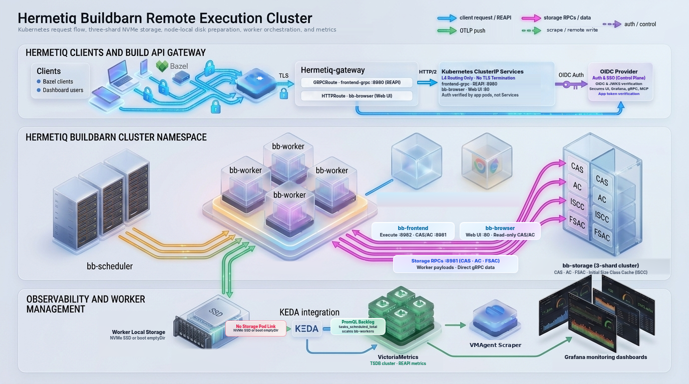

# Hermetiq Buildbarn Helm Chart

Production-ready **Buildbarn Helm chart** for Kubernetes: remote cache (CAS/AC),
remote build execution (RBE), Buildbarn Browser, and optionally the Remote Asset
API. The chart is also listed on
[Artifact Hub](https://artifacthub.io/packages/helm/hermetiq-buildbarn/buildbarn).

This README is the operator reference packaged with the Buildbarn chart. It
covers what the chart depends on, its values, the installation, and day-2
operations. The repository's
[installation guide](https://github.com/Hermetiq/hermetiq-k8s#installation)
gives the full-stack order (routing, identity provider, metrics stack,
Hermetiq, worker operator) and sends you here for its "Install Buildbarn and
worker pools" step. Install the [Hermetiq](../hermetiq/README.md) and
[bb-worker-operator](../bb-worker-operator/README.md) charts before this one:
the starter values point Buildbarn Browser at the `oauth2-proxy-config-web-ui`
ConfigMap and `oauth2-proxy-client` Secret that the Hermetiq install provides,
and `RbeWorker` pools need the operator's CRD.

How this README is organized:

- **Install** is a linear path. Read it top to bottom.
- **Configure** follows the blocks of the starter
  [`buildbarn-values.yaml`](https://github.com/Hermetiq/hermetiq-k8s/blob/main/custom-values/buildbarn-values.yaml),
  in the same order as the file, followed by the blocks that only the chart's
  `values.yaml` carries.
- The remaining parts are reference for optional features, production
  hardening, and operations.



For Buildbarn upstream background, see https://github.com/buildbarn.

## Contents

**Install**

- [What the chart installs](#what-the-chart-installs): workloads, service
  topology
- [Install prerequisites](#install-prerequisites): checklist
- [Configure your values file](#configure-your-values-file): what to set,
  block by block
- [Install](#install): pre-flight checks, the command, verification

**Configure** (same order as `buildbarn-values.yaml`)

- [Hosts](#hosts)
- [Jsonnet configuration](#jsonnet-configuration): config model, per-file
  overrides
- [Routing and TLS](#routing-and-tls): providers, Envoy Gateway policies,
  certificates
- [Storage](#storage): StorageClasses, persistent defaults, raw block devices,
  ISCC and FSAC
- [Image and configuration checks](#image-and-configuration-checks)
- [Frontend authentication and writes](#frontend-authentication-and-writes):
  JWT validation, write authorizers, JWKS sync
- [Browser SSO](#browser-sso)
- [Scheduler](#scheduler): predeclared queues, configuration reload, handover
- [Frontend autoscaling](#frontend-autoscaling)
- [Worker and runner](#worker-and-runner)
- [Worker autoscaling](#worker-autoscaling)
- [Tracing, metrics, and diagnostics](#tracing-metrics-and-diagnostics)
- [Scheduling](#scheduling)

**Optional features**

- [Frontend read cache](#frontend-read-cache)
- [Remote Asset API](#remote-asset-api)
- [bb-portal](#bb-portal)
- [Hermetiq grpc-cache-proxy sidecar](#hermetiq-grpc-cache-proxy-sidecar)
- [Testcontainers worker fleets](#testcontainers-worker-fleets)
- [Action routing and catch-all workers](#action-routing-and-catch-all-workers)

**Production readiness**

- [Large-scale deployments (10 TiB cache / 5–10 shards)](#large-scale-deployments-10-tib-cache--510-shards)
- [DIY mirrored storage (advanced)](#diy-mirrored-storage-advanced)
- [In-cluster mutual TLS](#in-cluster-mutual-tls)
- [Security and availability hardening](#security-and-availability-hardening):
  pod security, disruption budgets, network policies

**Operate**

- [Operations](#operations): workloads and logs, storage runbooks, sidecar
  image updates, upgrades
- [Troubleshooting](#troubleshooting)

**Project**

- [Local chart development](#local-chart-development)
- [License](#license)

## What the chart installs

| Workload | Kind | Role | Service ports |
|---|---|---|---|
| `frontend` | Deployment, optional KEDA `ScaledObject` | Entry point for Bazel: Remote Execution, CAS, ByteStream, and Action Cache APIs. Forwards execution requests to the scheduler and cache traffic to the storage shards. Runs the optional grpc-cache-proxy sidecar. | `frontend-grpc` 8980 (gRPC); `frontend-internal` 8980 for in-cluster clients |
| `scheduler-ubuntu22-04` | Deployment | Queues actions and assigns them to workers that match the requested platform properties. | `scheduler` 8982 (clients), 8983 (workers), 8984 (BuildQueueState), 7982 (web UI) |
| `storage` | StatefulSet, one Pod per shard | The CAS, Action Cache, ISCC, and FSAC stores. | `storage`, headless: 8981 (gRPC) |
| `browser` | Deployment | Buildbarn Browser UI, behind an optional oauth2-proxy sidecar. | `browser` 80 with oauth2-proxy, 7984 without |
| `remote-asset` | Deployment, when `remoteAsset.enabled` | Remote Asset Fetch API. Stores fetched blobs in CAS. | `remote-asset` and `remote-asset-grpc` on `remoteAsset.port`, 8985 by default (gRPC) |
| `bb-portal` | Deployment, when `portal.enabled` | bb-portal build-event dashboard and BES endpoint. | `bb-portal` 8081 (HTTP), 8082 (BES gRPC) |
| JWKS sync | CronJob and initial Job, when `frontend.jwks.sync.enabled` | Copies the identity provider's signing keys into the JWKS ConfigMap. | none |

Each workload also serves diagnostics and Prometheus metrics on `:9980`. The
`frontend-internal` ClusterIP Service is rendered when
`frontend.internalService.enabled=true` (the default); `bb-browser` reads CAS
through it.

The chart also renders:

- The `buildbarn-config` ConfigMap for browser, frontend, scheduler, storage,
  and remote asset Jsonnet, and the `buildbarn-worker-config` ConfigMap with
  the shared `common.libsonnet` for operator-managed workers.
- Routing resources for the provider you select: Contour `HTTPProxy`, Gateway
  API `HTTPRoute`/`GRPCRoute`, or nginx-style `Ingress`, with an optional
  cert-manager `Certificate` for Contour or Ingress routing.
- Optional PodDisruptionBudgets for storage, frontend, scheduler, Browser, and
  remote asset workloads.
- An optional NetworkPolicy that restricts the storage gRPC port to Buildbarn
  components and named peers (`storage.networkPolicy.enabled`), and one that
  restricts the scheduler's client, worker, and BuildQueueState ports to the
  frontend, workers, bb-portal, and named peers
  (`scheduler.networkPolicy.enabled`).
- Optional VictoriaMetrics `VMPodScrape` and `VMRule` resources.
- The JWKS sync ServiceAccount and RBAC when the sync is enabled.

Worker pools are managed through `RbeWorker` resources reconciled by the
[bb-worker-operator](../bb-worker-operator/README.md). This chart does not
render worker Deployments or worker KEDA `ScaledObject` resources.

The chart does not install a routing controller, cert-manager, KEDA, a metrics
backend, the bb-worker-operator, or an identity provider. The prerequisites
below and the repository guide cover them.

### Service topology

The chart follows Buildbarn's standard split:

- Clients connect to `frontend-grpc` for Remote Execution, CAS, ByteStream, and Action Cache APIs.
- `frontend` forwards execution requests to `scheduler`.
- `scheduler` assigns queued operations to workers matching the requested platform properties.
- `worker` containers fetch inputs from CAS, mount or materialize build inputs, call their local `runner` over a Unix socket, and upload outputs back to CAS.
- `storage` shards hold CAS and Action Cache data on persistent disks.
- `browser` provides the Buildbarn Browser UI. It reads CAS through the frontend on `:8980` and the Action Cache from the storage shards.
- `remote-asset`, when enabled, serves the Bazel Remote Asset Fetch API and stores fetched blobs in CAS.
- `bb-portal`, when enabled, serves the bb-portal build-event dashboard and BES endpoint (see [bb-portal](#bb-portal)).

## Install prerequisites

Everything in this section must exist before `helm` runs. Commands in this
README use the `hermetiq` namespace; substitute your own if it differs. They
also assume your shell is in the copied values directory from the repository's
[prepare custom values](https://github.com/Hermetiq/hermetiq-k8s#prepare-custom-values)
step.

Namespaced resources render into the release namespace (`--namespace`):

```yaml
namespaceOverride: ""
createNamespace: false
```

Set `namespaceOverride` to render into a different namespace, and
`createNamespace: true` if Helm should create it.

### Checklist

- [ ] **Kubernetes cluster and node pools**
  - Kubernetes `1.32+` with enough CPU, memory, and disk quota in the target
    namespace.
  - Dedicated **non-spot** nodes for `storage` pods. The default
    `storage.podAntiAffinity.enabled: true` already requires one shard per
    node, so a 5–10 shard deployment needs at least that many eligible nodes.
  - Elastic Linux `amd64` worker node pool(s) sized for your
    [`RbeWorker`](../../custom-values/rbeworkers/README.md) pods, with NVMe
    scratch disk if workers use local CAS caches.
- [ ] **Required cluster controllers and operators**
  - **Routing controller** matching `routing.provider`: Envoy Gateway or
    another GRPCRoute-capable Gateway API controller (`gateway`), GKE Gateway
    (`gateway-httproute-only`), Contour (`contour`), or an Ingress controller
    (`ingress`). Use `none` to bring your own routing.
  - **cert-manager** (or pre-created TLS certificate Secrets) for terminating
    TLS on `bb.<domainBase>` and `browser.<domainBase>`, plus
    `rbe-web.<domainBase>` and `asset.<domainBase>` if you expose the scheduler
    web UI or the Remote Asset API.
  - **KEDA 2.x** if using `RbeWorker` autoscaling (including scale-from-zero)
    or `keda.frontend` autoscaling.
  - **Metrics backend** reachable at `keda.prometheusServerAddress`. The chart
    renders `VMPodScrape` and `VMRule` resources by default
    (`vmPodScrapes.enabled`, `vmRules.enabled`), so either install the
    VictoriaMetrics Operator CRDs or set both to `false` and scrape with your
    own Prometheus configuration. Add Kubernetes `metrics-server` if you enable
    frontend CPU/memory KEDA triggers.
  - **[`bb-worker-operator`](../bb-worker-operator/README.md)** and its
    `RbeWorker` CRD, installed in the release namespace (`hermetiq` in this
    guide) with the default `rbac.mode=cluster` or with `rbac.mode=namespace`
    (see its [RBAC scope](../bb-worker-operator/README.md#rbac-scope)), so
    `RbeWorker` resources reconcile after the chart installs.
- [ ] **Target namespace and Pod Security Admission (PSA)**
  - Create the target namespace (for example, `hermetiq`).
  - Label it `pod-security.kubernetes.io/enforce=privileged` if you will run
    FUSE-based `RbeWorker` pools (every starter worker in
    `custom-values/rbeworkers/` uses a FUSE `virtualBuildDirectory`) or
    `hostPath` raw-block storage (`mode: hostPath` with `backend: blockDevice`).
    Raw-block PVCs with `blockDevice.deviceAccess: chownInit` need at least the
    `baseline` level.
    ```bash
    kubectl create namespace hermetiq --dry-run=client -o yaml | kubectl apply -f -
    kubectl label namespace hermetiq pod-security.kubernetes.io/enforce=privileged --overwrite
    ```
- [ ] **Storage provisioning and immutable PVC decisions (before first install)**
  - **PVC storage (`mode: pvc`)**: run `kubectl get storageclass` and pick a
    fast SSD StorageClass (for example `premium-rwo` or `hyperdisk-balanced` on
    GKE, `gp3` on EKS). Set it for every store that gets a claim: CAS, AC,
    ISCC and FSAC each have their own `storageClassName` (see
    [StorageClasses](#storageclasses)). Decide on
    `storage.persistence.iscc.enabled` and
    `storage.persistence.fsac.enabled` (both default to `true`) **before** the
    initial install (see
    [Decide before the first install](#decide-before-the-first-install)).
  - **Local NVMe raw block storage (`mode: hostPath`, `backend: blockDevice`)**:
    provision the node pool with raw unformatted NVMe SSDs
    (`--local-nvme-ssd-block` on GKE), deploy
    [`custom-values/partition-ephemeral-disks-daemonset.yaml`](../../custom-values/partition-ephemeral-disks-daemonset.yaml),
    and verify nodes carry the readiness label `hermetiq/ephemeral-lvm=ready`
    before installing Buildbarn.
  - **Key-location map (KLM) validation**: set
    `storage.keyLocationMapSizing.validate: true` so Helm verifies at render
    time that every store's KLM can index at least `2x` the objects its block
    capacity can hold.
- [ ] **DNS, TLS, OIDC, and registry Secrets**
  - DNS records for `bb.<domainBase>` and `browser.<domainBase>` (plus
    `rbe-web.` and `asset.` if enabled) pointing at your Gateway or Ingress
    external IP.
  - An image pull Secret (`imagePullSecrets` or `global.imagePullSecrets`)
    only if you mirror the chart's images into a private registry. The default
    images, including the Hermetiq `grpc-cache-proxy` sidecar, are public.
  - The `oauth2-proxy-client` OIDC Secret (the same one the Hermetiq chart's
    prerequisites create) and your IdP's JWKS URL if enabling
    `browser.oauth2Proxy` and `frontend.jwks`.

## Configure your values file

Start from the
[Buildbarn starter values](https://github.com/Hermetiq/hermetiq-k8s/blob/main/custom-values/buildbarn-values.yaml)
and edit your copied `buildbarn-values.yaml`. The starter holds the main
inputs; the chart's
[`values.yaml`](https://github.com/Hermetiq/hermetiq-k8s/blob/main/charts/buildbarn/values.yaml)
documents every setting.

Work through the file top to bottom. Each row names what to set in one block
and what happens if you leave the starter's example in place. The last column
links to the section that explains the block.

| Block | Set | If you skip it | Details |
|---|---|---|---|
| `hosts` | `domainBase`; `otel` to your collector's in-cluster host name | Routes are rendered for hosts under the example domain, which your DNS and TLS do not cover. | [Hosts](#hosts) |
| `config` | `maximumMessageSizeBytes` | The starter's 800 MiB limit applies. Size Pod memory for requests that large, or lower it. | [Jsonnet configuration](#jsonnet-configuration) |
| `routing` | `provider`, to match your routing controller | The starter's `gateway` provider renders Envoy Gateway policy kinds, and the install fails on another controller. | [Routing and TLS](#routing-and-tls) |
| `storage` | `resources`, the shard count and store sizes, and each store's `storageClassName` | A claim that names a StorageClass the cluster does not have stays `Pending`, and no shard starts. Claim templates cannot be changed in place afterwards. | [Storage](#storage), [Decide before the first install](#decide-before-the-first-install) |
| `images` | Nothing, unless you mirror images or pin another grpc-cache-proxy release | The starter's pinned sidecar image applies. | [Image and configuration checks](#image-and-configuration-checks), [Update the sidecar independently of the chart](#update-the-sidecar-independently-of-the-chart) |
| `frontend` | `jwks.issuer`, `jwks.audience`, and `jwks.sync.url` for your identity provider | The frontend cannot validate your tokens, so uploads, Action Cache writes, and Execute are refused. Reads stay open. | [Frontend authentication and writes](#frontend-authentication-and-writes) |
| `browser` | Keep `oauth2Proxy.enabled`, or point it at your own OAuth configuration | The starter relies on the `oauth2-proxy-config-web-ui` ConfigMap and `oauth2-proxy-client` Secret from the Hermetiq install. | [Browser SSO](#browser-sso) |
| `scheduler` | `predeclaredPlatformQueues`, one entry for every pool that can scale to zero; `sizeClassAnalysis` | Actions for a pool at zero replicas fail with `No workers exist` instead of queueing. | [Scheduler](#scheduler) |
| `keda` | `frontend.enabled`; `prometheusServerAddress` when your metrics endpoint differs from the chart default | The frontend scaler queries the chart's default metrics address. | [Frontend autoscaling](#frontend-autoscaling) |
| `gateway` | `name` and, if needed, `namespace`; `cors.allowOrigins` to your dashboard origin | Routes attach to a Gateway named `hermetiq-gateway` in the release namespace, and only the example dashboard origin may call Buildbarn Browser across origins. | [Routing and TLS](#routing-and-tls) |

Replace every placeholder, including the example domain `helm.hermetiq.dev`
and the `<tenant>` issuer URLs, and confirm that each ConfigMap, Secret, and
Gateway the file names exists.

### Decide before the first install

> [!IMPORTANT]
> **Decide on `iscc`, `fsac`, backend type, and shard sizing before your first
> `helm install` when using `mode: pvc`.**
>
> Kubernetes rejects changes to an existing StatefulSet's
> `volumeClaimTemplates`. Changing either default-enabled
> `storage.persistence.iscc.enabled` or `storage.persistence.fsac.enabled`,
> switching between
> `backend: filesystem` and `backend: blockDevice`, or changing a store's
> `size` or `storageClassName` after the initial install makes `helm upgrade`
> fail until the `storage` StatefulSet is recreated. The chart compares the
> live StatefulSet with the render and fails before anything is applied,
> listing the differences. Follow
> [Recreate the Storage StatefulSet](../../docs/buildbarn-storage-operations.md#recreate-the-storage-statefulset);
> to grow an existing volume in place first, see
> [Resize a Store](../../docs/buildbarn-storage-operations.md#resize-a-store).
>
> Every starter worker in
> [`custom-values/rbeworkers/`](../../custom-values/rbeworkers/README.md)
> enables `spec.config.generated.prefetching`, which requires
> `storage.persistence.fsac.enabled: true` so `common.libsonnet` exports
> `fileSystemAccessCache`. Keep `iscc.enabled: true` and `fsac.enabled: true`
> (as in
> [`custom-values/buildbarn-values.yaml`](../../custom-values/buildbarn-values.yaml))
> unless you remove `prefetching` and size-class routing from your workers.

Choose the starting configuration that matches your cluster and target scale:

| Deployment profile | Recommended storage mode | Starter values / reference |
|---|---|---|
| **Standard durable PVC** (dev, staging, or moderate production) | `mode: pvc`, `backend: filesystem` (`premium-rwo`, `hyperdisk-balanced`, or `gp3`) | [`custom-values/buildbarn-values.yaml`](../../custom-values/buildbarn-values.yaml) |
| **High-IOPS ephemeral Local NVMe** (1 to 10 shards on local NVMe LVs) | `mode: hostPath`, `backend: blockDevice` (`partition-ephemeral-disks` DaemonSet) | [`custom-values/buildbarn-values-local-ssd-block.yaml`](../../custom-values/buildbarn-values-local-ssd-block.yaml) |
| **Large-scale 10 TiB cache** (5 × 2 TiB or 10 × 1 TiB shards) | `mode: pvc` (`backend: blockDevice` with `keyLocationMap: file`, or `backend: filesystem`) or multi-NVMe `hostPath` | See [Large-scale deployments (10 TiB cache / 5–10 shards)](#large-scale-deployments-10-tib-cache--510-shards) |

### Co-installing with the Hermetiq chart

When deploying Buildbarn in the same namespace and behind the same Gateway as
the [`hermetiq`](../hermetiq/README.md) chart, check these cross-chart settings
in `buildbarn-values.yaml` and `hermetiq-values.yaml`:

1. **Browser sign-in reuses Hermetiq's oauth2-proxy resources.** The starter
   values keep `browser.oauth2Proxy.existingConfigMap` at
   `oauth2-proxy-config-web-ui` and `client.existingSecret` at
   `oauth2-proxy-client`, both provided through the Hermetiq install, which is
   why Hermetiq installs first. Set `existingConfigMap: ""` and
   `oidcIssuerUrl` to render a Buildbarn-specific ConfigMap instead (see
   [Browser SSO](#browser-sso)).
2. **One `ClientTrafficPolicy` per Gateway listener.** Neither starter enables
   `gateway.clientTrafficPolicy`. If you turn it on and both charts attach to
   the shared `hermetiq-gateway`, enable it in one chart only: Envoy Gateway
   accepts a single policy per listener and marks a second one
   `Overridden=True`.
3. **Predeclared platform queues for workers that idle to zero.** Starter
   pools `worker-ubuntu22-04` and `worker-codex` start at `replicas: 0` with
   `minReplicas: 0`; `worker-envoy` keeps `minReplicas: 4` but `idleReplicas: 0`
   and also scales to zero. Every such platform must appear under
   `scheduler.predeclaredPlatformQueues` in `buildbarn-values.yaml`, matching
   the pool's `spec.config.generated.platformProperties` exactly (see
   [Scheduler](#scheduler)); otherwise actions for that pool fail with
   `No workers exist` instead of queueing and triggering KEDA.
4. **`grpc-cache-proxy` NATS shard count.** When enabling
   `frontend.grpcCacheProxy.enabled: true`, set
   `frontend.grpcCacheProxy.cacheEvents.numShards` equal to
   `app.streamPartitionCount` in `hermetiq-values.yaml` (the starter uses `4`),
   and keep `cacheEvents.subjectPrefix` equal to `cache.subjectPrefix` in the
   Hermetiq chart's packaged NATS stream config (`cache` by default).
5. **Completed Action Logs (CAL) CIDR allowlist.** The starter `RbeWorker`
   manifests stream Completed Action Logs to `bep-nats-pub:50091`
   (`completedActionLoggerAddress`). The Hermetiq chart ships
   `publisher.trustedCalCidrs` empty, which rejects every CAL stream, so set it
   in `hermetiq-values.yaml` to your cluster's Pod CIDR (and Node CIDR if any
   workers use `hostNetwork`).
6. **Chart versions.** Run this chart with the Hermetiq and
   bb-worker-operator charts from the same
   [supported chart bundle](../../README.md#supported-chart-bundle). Hermetiq
   reads and validates the configuration this chart renders, and the operator
   generates the worker configuration that matches it.

### Inspect the packaged defaults

Read the exact defaults and README of the version you are installing before
writing advanced overrides:

```bash
helm show values oci://ghcr.io/hermetiq/buildbarn --version 1.0.1
helm show readme oci://ghcr.io/hermetiq/buildbarn --version 1.0.1
```

## Install

### Pre-flight checks

Run these before installing. Use the namespace and object names from your own
values where they differ from the starter.

1. Confirm that the Hermetiq install and the worker operator are in place: the
   OAuth ConfigMap and Secret that Browser reuses, and the `RbeWorker` CRD.

   ```bash
   kubectl -n hermetiq get configmap oauth2-proxy-config-web-ui
   kubectl -n hermetiq get secret oauth2-proxy-client
   kubectl wait --for=condition=Established crd/rbeworkers.bb.hermetiq.com --timeout=60s
   ```

2. Confirm that the cluster has every StorageClass your values name; see
   [StorageClasses](#storageclasses).

   ```bash
   kubectl get storageclass
   ```

3. Render the chart. A missing or conflicting value stops the render with a
   message that names it:

   ```bash
   helm template buildbarn oci://ghcr.io/hermetiq/buildbarn \
     --version 1.0.1 \
     --namespace hermetiq \
     --values buildbarn-values.yaml > /tmp/buildbarn.yaml
   ```

4. Run the install as a server-side dry run. It applies nothing and runs the
   checks that read the cluster; see
   [Image and configuration checks](#image-and-configuration-checks).

   ```bash
   helm upgrade --install --namespace hermetiq buildbarn \
     oci://ghcr.io/hermetiq/buildbarn \
     --version 1.0.1 \
     --values buildbarn-values.yaml \
     --dry-run=server > /dev/null
   ```

### Run the install

After the Hermetiq chart and worker operator are installed, install Buildbarn:

```bash
helm upgrade --install --namespace hermetiq buildbarn \
  oci://ghcr.io/hermetiq/buildbarn \
  --version 1.0.1 \
  --values buildbarn-values.yaml
```

If the command fails before creating resources, rerun the `helm template`
step with `--debug` and read the validation error before changing a value.

### Verify the installation

Before applying worker pools, check the Buildbarn workloads:

```bash
kubectl get deploy browser frontend scheduler-ubuntu22-04 -n hermetiq
kubectl get sts storage -n hermetiq
```

Check endpoints:

```bash
kubectl get endpoints browser frontend-grpc scheduler storage -n hermetiq
```

If bb-portal is enabled, also check:

```bash
kubectl get endpoints bb-portal -n hermetiq
```

If Remote Asset API is enabled, also check:

```bash
kubectl get endpoints remote-asset remote-asset-grpc -n hermetiq
```

Inspect routes for your provider:

```bash
kubectl get httpproxy -n hermetiq
kubectl get httproute,grpcroute -n hermetiq
kubectl get httproute,healthcheckpolicy,gcpbackendpolicy -n hermetiq
kubectl get ingress -n hermetiq
```

If VictoriaMetrics resources are enabled, check scrapes and recording rules:

```bash
kubectl get vmpodscrape,vmrule -n hermetiq
```

After applying worker pools, check their `RbeWorker` resources. Each resource
reports the managed Deployment name and Pod selector in its status:

```bash
kubectl -n hermetiq get rbeworkers
kubectl -n hermetiq describe rbeworker worker-ubuntu22-04

SELECTOR=$(kubectl -n hermetiq get rbeworker worker-ubuntu22-04 \
  -o jsonpath='{.status.selector}')
DEPLOY=$(kubectl -n hermetiq get rbeworker worker-ubuntu22-04 \
  -o jsonpath='{.status.deploymentName}')

kubectl -n hermetiq get pods -l "$SELECTOR"
kubectl -n hermetiq logs deploy/"$DEPLOY" -c worker
kubectl -n hermetiq logs deploy/"$DEPLOY" -c runner
```

Confirm the frontend accepts your JWT and advertises remote execution and
Action Cache writes:

```bash
export JWT="..."

grpcurl -H "authorization: Bearer $JWT" -d @ \
  bb.<your-domain>:443 \
  build.bazel.remote.execution.v2.Capabilities/GetCapabilities \
  <<<'{"instance_name":"0"}' | jq '.executionCapabilities.execEnabled'

grpcurl -H "authorization: Bearer $JWT" -d @ \
  bb.<your-domain>:443 \
  build.bazel.remote.execution.v2.Capabilities/GetCapabilities \
  <<<'{"instance_name":"0"}' | jq '.cacheCapabilities.actionCacheUpdateCapabilities'
```

Expect `true` for `execEnabled` and `{"updateEnabled": true}` for the Action
Cache. Use the Hermetiq project ID as the instance name so the grpc-cache-proxy
sidecar, when enabled, attributes the lookups to that project.

### Next steps

Resolve Pods stuck in `Pending` or `CrashLoopBackOff` before continuing;
[Troubleshooting](#troubleshooting) lists the common causes. When the
Buildbarn services are healthy:

1. Follow the
   [RBE worker pool instructions](https://github.com/Hermetiq/hermetiq-k8s/blob/main/custom-values/rbeworkers/README.md)
   to apply the worker manifests using a Kustomize overlay
   (`kubectl apply --namespace hermetiq --kustomize rbeworkers`), then return
   to [Verify the installation](#verify-the-installation) to check those
   pools.
2. Continue with the repository guide's
   [Verify the stack](https://github.com/Hermetiq/hermetiq-k8s#verify-the-stack)
   and
   [post-installation configuration](https://github.com/Hermetiq/hermetiq-k8s#post-installation-configuration).

Come back to the reference sections below when your environment needs them.

## Hosts

**Values:** `hosts`. The starter sets `domainBase` and `otel`.

The default host names derive from `hosts.domainBase`:

```yaml
hosts:
  domainBase: bb.helm.hermetiq.dev
```

This produces:

- `browser.<domainBase>` for Buildbarn Browser.
- `bb.<domainBase>` for frontend gRPC.
- `rbe-web.<domainBase>` for scheduler web UI.
- `asset.<domainBase>` for Remote Asset API when enabled.
- `portal.<domainBase>` and `bes.<domainBase>` for bb-portal when enabled.

Set `hosts.browser`, `hosts.frontendGrpc`, `hosts.rbeWeb`, `hosts.remoteAsset`,
`hosts.portal`, or `hosts.bes` to override any individual host.

## Jsonnet configuration

**Values:** `config`, `configOverrides`. The starter sets
`config.maximumMessageSizeBytes`.

### Jsonnet config model

Buildbarn itself is configured through Jsonnet. The chart renders two ConfigMaps:

- `buildbarn-config` from the chart's `files/config/` directory.
- `buildbarn-worker-config` with the shared `common.libsonnet`.

The operator combines that shared file with the worker and runner Jsonnet it
generates for each `RbeWorker`, so workers use the chart's sharded storage and
message size settings.

The chart hashes the generated Jsonnet files into the Pod templates that use
them, so changing those files or their values in a Helm upgrade rolls the
affected Buildbarn Deployments and StatefulSet. `RbeWorker` pools use
`spec.config.rolloutOnChange: true` in the starter manifests to roll when
their mounted shared ConfigMap changes.

Some Jsonnet files are Helm-templated before landing in the ConfigMap. For
example:

- `common.libsonnet` renders storage shard addresses and tracing settings.
- `frontend.jsonnet` renders JWKS auth, CAS/Action Cache/Execute authorizers, read cache settings, and trace attributes.
- `storage.jsonnet` renders persistence sizing.
- The worker operator generates worker concurrency, caches, platform properties,
  completed action logging, and runner options from each `RbeWorker`.
- `asset.jsonnet` renders Remote Asset API port and fetch/push behavior.

### Per-file Jsonnet overrides

Use `configOverrides` when a value is too specific or too deep for the chart
values model:

```bash
helm upgrade --install --namespace hermetiq buildbarn \
  oci://ghcr.io/hermetiq/buildbarn \
  --version 1.0.1 \
  --values buildbarn-values.yaml \
  --set-file 'configOverrides.frontend\.jsonnet'=./my-frontend.jsonnet
```

Keys must match a filename in `files/config/`.
Unknown keys fail `helm template` with the valid filenames.

Overrides are verbatim. Helm templating is not applied to override contents, so
if you override a templated file you own all values that the chart would normally
inject into that file.

Override-able files:

| Map | Filename |
| --- | --- |
| `configOverrides` | `asset.jsonnet` |
| `configOverrides` | `browser.jsonnet` |
| `configOverrides` | `common.libsonnet` |
| `configOverrides` | `frontend.jsonnet` |
| `configOverrides` | `scheduler.jsonnet` |
| `configOverrides` | `portal.jsonnet` |
| `configOverrides` | `storage.jsonnet` |
`configOverrides.common.libsonnet` propagates to both ConfigMaps.

## Routing and TLS

**Values:** `routing`, `gateway`, `httpProxy`, `ingress`, `certificate`, `tls`. The starter
selects `routing.provider: gateway`, names the Gateway, sets the Browser CORS
origin, and turns the scheduler web route off.

The chart supports four built-in routing providers plus a disabled mode for
user-managed routing:

```yaml
routing:
  enabled: true
  provider: contour # contour, gateway, gateway-httproute-only, ingress, or none
```

`contour` renders:

- `HTTPProxy` for frontend gRPC.
- `HTTPProxy` for Browser.
- `HTTPProxy` for RBE web scheduler.
- `HTTPProxy` for Remote Asset API when `remoteAsset.enabled` and `ingress.remoteAssetGrpc.enabled` are both true.
- `HTTPProxy` resources for bb-portal (`portal.` HTTP and `bes.` h2c gRPC) when `portal.enabled` is true.

`gateway` renders:

- `HTTPRoute` for Browser.
- `HTTPRoute` for RBE web scheduler.
- `GRPCRoute` for frontend gRPC.
- `GRPCRoute` for Remote Asset API when `remoteAsset.enabled` and `gateway.grpcRoutes.remoteAsset.enabled` are both true.
- `HTTPRoute` for the portal UI and `GRPCRoute` for BES when `portal.enabled` is true.
- Envoy Gateway `BackendTrafficPolicy` for long-lived frontend gRPC streams when enabled.
- Envoy Gateway `SecurityPolicy` for Browser CORS when enabled.
- Envoy Gateway `ClientTrafficPolicy` tuning downstream buffers, HTTP/2 flow control, and connection lifetime when enabled.

`gateway-httproute-only` renders:

- `HTTPRoute` for Browser.
- `HTTPRoute` for RBE web scheduler.
- `HTTPRoute` for frontend gRPC.
- `HTTPRoute` for Remote Asset API when `remoteAsset.enabled` and `gateway.grpcRoutes.remoteAsset.enabled` are both true.
- GKE `HealthCheckPolicy` and `GCPBackendPolicy` resources for the routed Services.

`ingress` renders nginx-style `Ingress` resources for Browser, RBE web,
frontend gRPC, Remote Asset API when `remoteAsset.enabled` and
`ingress.remoteAssetGrpc.enabled` are both true, and bb-portal (`portal.` plus
a GRPC-protocol `bes.` Ingress) when `portal.enabled` is true.

Set `routing.enabled=false` or `routing.provider=none` when you want the chart
to render only internal Services and application resources while you supply
your own Gateway, Ingress, HTTPProxy, service mesh route, or other external
routing implementation. Route TLS Certificates, Envoy Gateway policies, and GKE
Gateway policies are also skipped in this mode.

Gateway modes assume TLS is configured on the referenced Gateway. **Note:**
switching to `gateway` or `gateway-httproute-only` from `contour` or `ingress`
stops rendering the cert-manager `Certificate` resource even when
`certificate.enabled` is true. You must configure TLS termination on your
Gateway listener.

Set `gateway.name` and optionally `gateway.namespace`:

```yaml
routing:
  provider: gateway
gateway:
  name: shared-gateway
  namespace: gateway-system
```

For advanced Gateway API parent references, set `gateway.parentRefs` directly.
When non-empty, it overrides `gateway.name` and `gateway.namespace`.

Use `gateway-httproute-only` for GKE Gateway, which supports HTTPRoute but not
GRPCRoute. Use `gateway` for Envoy Gateway and other controllers that support
GRPCRoute. If your cluster uses older Gateway API CRDs, override
`gateway.httpRouteApiVersion` or `gateway.grpcRouteApiVersion`.

### Envoy Gateway policies

`routing.provider=gateway` renders Envoy Gateway `gateway.envoyproxy.io`
resources alongside the standard routes: `BackendTrafficPolicy` for the
long-lived gRPC stream timeouts, `SecurityPolicy` for Browser CORS, and the
optional `ClientTrafficPolicy`. On a `GRPCRoute`-capable controller that is not
Envoy Gateway those kinds do not exist and the install fails on unknown kinds.
Disable them:

```yaml
gateway:
  cors:
    enabled: false
  grpcRoutes:
    frontend:
      backendTrafficPolicy:
        enabled: false
    bes:
      backendTrafficPolicy:
        enabled: false
    remoteAsset:
      backendTrafficPolicy:
        enabled: false
  clientTrafficPolicy:
    enabled: false
```

Without the timeout policies, whatever default route timeout your controller
applies governs `ByteStream` transfers and BES uploads; check that it does not
truncate them.

### Tuning the downstream leg for high-RTT Bazel clients

`gateway.clientTrafficPolicy` renders an Envoy Gateway `ClientTrafficPolicy`
(`routing.provider=gateway` only) covering the client → Envoy leg. It is
disabled by default; enable it when Bazel clients are far from the cluster.
When enabled, it advertises `h2` for gRPC and `http/1.1` for browser traffic
through `spec.tls.alpnProtocols` on TLS listeners.

> **Installing the hermetiq chart too?** Enable it there instead. The policy is
> Gateway-scoped, so one covers both charts' routes, and `ClientTrafficPolicy`
> resources do not merge — enable it in exactly one chart or the oldest wins and
> the other reports `Overridden=True`. This copy is for standalone Buildbarn
> installs.

```yaml
routing:
  provider: gateway
gateway:
  name: shared-gateway
  clientTrafficPolicy:
    enabled: true
    # Optional: restrict to one listener instead of the whole Gateway.
    sectionName: https
```

Envoy Gateway's own defaults are conservative for remote cache/execution
traffic. Measured against v1.7.2, it programs a 32Ki per-connection buffer
limit, a 64Ki HTTP/2 stream window, a 1Mi connection window, 100 concurrent
streams, and a 1h idle timeout. The per-connection buffer limit matters most:
at 32Ki, CAS blob transfer hits watermark backpressure almost immediately and
every drain/refill cycle costs a full client round trip. The HTTP/2 windows are
a second, independent cap — raising only `bufferLimit` can still produce
`413 request_payload_too_large`.

Two caveats. `bufferLimit` is per-connection memory on the Envoy proxy, which
frequently runs a single replica, so watch its RSS after enabling. And a policy
without `sectionName` applies to every route on the Gateway, not just
Buildbarn's — `ClientTrafficPolicy` resources do not merge, so a listener-scoped
policy fully overrides a Gateway-scoped one rather than combining with it.

Some adjacent knobs are deliberately not exposed. `spec.timeout.tcp` only
applies to TCP and TLS-passthrough listeners, so it is a silent no-op where
Envoy terminates TLS and speaks HTTP/2. `spec.connection.connectionLimit` risks
capping concurrency for little benefit at build-cluster client counts. HTTP/2
keepalive PINGs are not part of `ClientTrafficPolicy` at all and need an
`EnvoyPatchPolicy`. Raising the idle timeout is what actually prevents
connection churn: Envoy's HTTP idle timeout is request-based, so neither PINGs
nor TCP keepalives reset it.

### TLS certificates

Contour and Ingress modes use a shared TLS secret. If `tls.secretName` is set,
the chart uses that existing Secret. Otherwise, when `certificate.enabled` is
true, it renders a cert-manager `Certificate` named by `certificate.name` with
`*.hosts.domainBase` plus the concrete Browser, frontend gRPC, RBE web, and
optional Remote Asset hostnames.

`certificate.enabled` defaults to `true` and `certificate.issuerRef.name`
defaults to `lets-encrypt-issuer`, so a Contour or Ingress install renders a
`bb-wildcard-cert` Certificate unless you act. Install cert-manager in the
cluster and point `certificate.issuerRef` at an existing issuer (`ClusterIssuer`
by default) before using chart-managed TLS. Alternatively, set
`tls.secretName` to reuse a wildcard Secret you already manage, or set
`certificate.enabled: false` and
manage the route TLS Secrets yourself. If the referenced issuer does not
exist, the Certificate stays pending and the routes serve no usable TLS.

## Storage

**Values:** `storage`. The starter sets the shard resources, turns on
`keyLocationMapSizing.validate`, and keeps ISCC and FSAC enabled.

Storage is a sharded StatefulSet. The number of shards is `storage.replicas`;
`common.libsonnet` generates one CAS and Action Cache shard entry per replica.

### Stage a replacement storage release

Chart 1.0.1 adds three values for a separate storage release in the same
namespace:

| Value | Default | Effect |
|---|---|---|
| `deploymentMode` | `full` | `storage-only` creates storage and its supporting resources. |
| `storage.name` | `storage` | Names the StatefulSet and headless Service, and supplies the storage target in generated client configuration. |
| `storage.enabled` | `true` | `false` leaves storage resources to another release while keeping clients configured for `storage.name` and `storage.replicas`. |

To prepare a fresh storage ring without changing the current application, install
a separate release with the desired storage sizing and scheduling settings:

```yaml
# storage-green.yaml
deploymentMode: storage-only
storage:
  enabled: true
  name: storage-cdc
  replicas: 3
```

Use an existing namespace. This release creates `storage-cdc`, its headless
Service, and `storage-cdc-config`, plus storage's enabled disruption budget,
network policy and metrics scrape. It does not create the namespace, application
workloads, worker configuration, public routes, certificates or `extraObjects`.
The default `app: storage-cdc` selectors keep both storage rings separate;
`kubernetes_service: storage` preserves the metrics conventions. Optional
`storage.topologySpreadConstraints` are passed to the Pod spec; use
`labelSelector.matchLabels.app: storage-cdc` when spreading this ring across zones.

Once the new shards are ready, upgrade the original full release using its
application values and these overrides:

```yaml
deploymentMode: full
storage:
  enabled: false
  name: storage-cdc
  replicas: 3
```

Keep `storage.replicas`, the enabled ISCC/FSAC stores, and in-cluster mTLS settings
consistent between both releases. Generated clients dial
`storage-cdc-<ordinal>.storage-cdc.<namespace>:8981`. Certificates must cover those
names. An external-storage release rejects a `common.libsonnet` override because
it would bypass the generated target; update custom worker configuration separately.

This upgrade removes the original storage StatefulSet and supporting resources.
Kubernetes retains its PVCs by default; remove them manually after validating the
cutover and deciding rollback is no longer needed. Application ConfigMap checksums
roll the chart's client workloads, but worker restarts and any image/operator
upgrade need a coordinated maintenance window. There is no automatic cache copy,
fallback or zero-downtime guarantee. Rollback to the previous Helm revision
recreates the old StatefulSet against its retained PVCs; coordinate worker images
and configuration with that rollback too.

### Storage sizing

Use the focused repository runbooks for planning and live operations:

- [storage model and sizing](https://github.com/Hermetiq/hermetiq-k8s/blob/main/docs/buildbarn-storage-model.md)
- [storage operations](https://github.com/Hermetiq/hermetiq-k8s/blob/main/docs/buildbarn-storage-operations.md)
- [raw block-device storage](https://github.com/Hermetiq/hermetiq-k8s/blob/main/docs/buildbarn-block-storage.md)
- [ISCC size classes](https://github.com/Hermetiq/hermetiq-k8s/blob/main/docs/iscc-size-classes.md)

The chart stores CAS and Action Cache data on PVC-backed persistent disks by
default:

```yaml
storage:
  replicas: 5
  keyLocationMapSizing:
    validate: true
  persistence:
    mode: pvc
    cas:
      storageClassName: premium-rwo
      size: 1Ti
      blocksSizeGi: 900
      keyLocationMapSizeMi: 7680
    ac:
      storageClassName: premium-rwo
      size: 20Gi
      blocksSizeGi: 10
      keyLocationMap:
        type: blockDevice
        sizeMi: 2048
```

`blocksSizeGi` plus the on-disk key-location map (`keyLocationMapSizeMi` for
the CAS, `keyLocationMap.sizeMi` for the other stores) must leave headroom
inside `size` for `persistent_state` and filesystem metadata; the chart refuses
to render when it does not. The CAS volume also holds the shared CMS: its 1 GiB
blocks file and 1280 MiB index (2304 MiB by default) count against `cas.size`.
ISCC and FSAC are enabled by default and get their own claims, each with its
own `storageClassName`. Enable `storage.keyLocationMapSizing.validate: true`
so Helm also verifies that every store's key-location map can index at least
`2x` the objects its block capacity can hold. Changing shard count or storage
layout after builds have run can invalidate or strand cache data, so size these
values carefully before production use.

For maximum local I/O, use NVMe-backed storage without PVCs. File-backed
indexes on retained hostPath storage survive pod replacement on the same node;
node loss or rescheduling can still erase a shard. With `emptyDir`, pod
replacement also erases the shard. There is no automatic data migration between
PVC, `emptyDir`, and `hostPath`; changing an existing release requires manually
recreating the StatefulSet because `volumeClaimTemplates` are effectively
immutable.

On GKE Local SSD-backed ephemeral storage node pools, prefer `emptyDir` and
schedule the storage pods onto nodes with the Local SSD ephemeral-storage label:

```yaml
storage:
  nodeSelector:
    cloud.google.com/gke-ephemeral-storage-local-ssd: "true"
  resources:
    requests:
      ephemeral-storage: 900Gi
    limits:
      ephemeral-storage: 1000Gi
  persistence:
    mode: emptyDir
    cas:
      size: 1000Gi
      blocksSizeGi: 900
      emptyDir:
        sizeLimit: 1000Gi
    ac:
      size: 20Gi
      blocksSizeGi: 10
      emptyDir:
        sizeLimit: 20Gi
    iscc:
      emptyDir:
        sizeLimit: 2Gi
    fsac:
      emptyDir:
        sizeLimit: 6Gi
```

In this mode every enabled filesystem store needs an `emptyDir.sizeLimit`, and
the render fails without one. That includes ISCC and FSAC, which are enabled by
default; set a store's `enabled: false` instead if you do not use it. Each
limit must hold the store's blocks file and index, and the CAS limit also the
shared CMS (2304 MiB by default).

If your nodes expose mounted NVMe storage through a stable path, use `hostPath`:

```yaml
storage:
  nodeSelector:
    cloud.google.com/gke-ephemeral-storage-local-ssd: "true"
  persistence:
    mode: hostPath
    cas:
      hostPath:
        path: /mnt/stateful_partition/kube-ephemeral-ssd/buildbarn-storage/cas
        type: DirectoryOrCreate
    ac:
      hostPath:
        path: /mnt/stateful_partition/kube-ephemeral-ssd/buildbarn-storage/ac
        type: DirectoryOrCreate
    iscc:
      hostPath:
        path: /mnt/stateful_partition/kube-ephemeral-ssd/buildbarn-storage/iscc
        type: DirectoryOrCreate
    fsac:
      hostPath:
        path: /mnt/stateful_partition/kube-ephemeral-ssd/buildbarn-storage/fsac
        type: DirectoryOrCreate
```

These are the chart defaults for a GKE Local SSD ephemeral-storage node. Set
all four paths when your mount is elsewhere. `DirectoryOrCreate` lets the
kubelet create a missing directory, and where the path is not a mounted SSD it
creates it on the node boot disk. For that reason the render fails when CAS is
moved off the default path, or is a raw block device, while an enabled
filesystem-backed ISCC or FSAC is still on its default path: give that store a
`hostPath.path` next to the other stores, or set its `enabled: false`. AC is
not covered by that check.

Storage pods are resource intensive in production. Make sure the target namespace
has quota for the configured CPU, memory, disk, or ephemeral-storage requests.

### StorageClasses

Check `kubectl get storageclass` and set the StorageClass of every store that
gets a claim. Each store has its own value and none of them follows the CAS
setting:

- `storage.persistence.cas.storageClassName`
- `storage.persistence.ac.storageClassName`
- `storage.persistence.iscc.storageClassName`
- `storage.persistence.fsac.storageClassName`

ISCC and FSAC are enabled by default and each has its own claim. The chart
defaults all four to the GKE-style name `premium-rwo`; on EKS, use `gp3` unless
your cluster provides a `premium-rwo` alias backed by EBS gp3. A store with
`backend: blockDevice` takes its classes from
`storage.persistence.<store>.blockDevice.storageClassName` (empty by default,
which is the cluster's default class) and
`storage.persistence.<store>.blockDevice.metadata.storageClassName` (default
`premium-rwo`) instead. Set both, to classes whose volumes are lost together.
A dedicated CMS (`storage.persistence.cms.backend: filesystem` or
`blockDevice`) has the same values under `storage.persistence.cms`.

A claim that names a StorageClass the cluster does not have stays `Pending`,
and so does its pod. Storage pods start in order, so while `storage-0` is
Pending no shard comes up. A claim keeps the class it was created with:
correcting the value afterwards means deleting the Pending claims and
[recreating the StatefulSet](../../docs/buildbarn-storage-operations.md#recreate-the-storage-statefulset).
In `mode: pvc` the install notes print `WARNING: STORAGE CLASS MISMATCH` when a
store's class differs from the CAS class or a raw store's blocks and metadata
classes differ, but only after the release has been applied.

### Persistent defaults and ephemeral opt-out

All five backing stores—CAS, CMS, AC, ISCC, and FSAC—use disk-backed indexes by
default, and ISCC and FSAC are enabled. Set `storage.persistence.iscc.enabled`
or `storage.persistence.fsac.enabled` to `false` to omit an unused store.
Scheduler size-class analysis and worker prefetching remain separate opt-ins.
Frontend read caches remain volatile.

| Deployment | Index and checkpoint placement | Recovery boundary |
|---|---|---|
| Filesystem PVC | Existing data PVC | Pod replacement; node rescheduling when the PV is durable and attachable |
| Raw-block PVC | Companion `<store>-meta` filesystem PVC | Both blocks and metadata PVCs must survive |
| Raw local NVMe (`hostPath`) | Explicit `blockDevice.metadata.hostPath.path` per raw store; the directory must already exist | Same retained node, blocks device, and metadata filesystem |
| Filesystem `emptyDir` | Pod's ephemeral volume | Container-only restart; replacing the pod loses the store |

Blocks and metadata must share a lifecycle: reset them together when either is
replaced. Retained indexes over lost blocks can falsely report blobs as present.
Shared CMS keeps its blocks, index, and state on the CAS filesystem or raw CAS
metadata volume. Include its default 1Gi blocks and 1280Mi index (2304 MiB) in
that volume's capacity; the default CAS claim and the default 10Gi raw CAS
metadata claim both hold it. Dedicated CMS backends also use persistent indexes
by default, and a dedicated filesystem CMS claim defaults to 4Gi.

With all five stores enabled, the default index files total 10304 MiB
(10.06 GiB) on filesystem backends (CAS 7168, CMS 1280, AC 1344, ISCC 256,
FSAC 256) and 11008 MiB (10.75 GiB) on raw-block backends with shared CMS (CAS
7360, CMS 1280, AC 1344, ISCC 512, FSAC 512). The default
`storage.resources.requests.memory` of `4Gi` does not keep that much index in
the page cache; raise it for a warm index as described under
[Large-scale deployments](#large-scale-deployments-10-tib-cache--510-shards).

An explicit `inMemory` override in your values wins over these defaults.
[`custom-values/buildbarn-values-persistent.yaml`](../../custom-values/buildbarn-values-persistent.yaml),
applied after deployment values, selects the default index modes again without
changing enablement, backends, sizes, paths, StorageClasses, or resource
budgets. A deployment on chart defaults does not need it. Moving a store from
an in-memory index to a file index starts that store empty, and on a raw PVC
store it adds a `<store>-meta` claim template, which needs the
[StatefulSet recreated](../../docs/buildbarn-storage-operations.md#recreate-the-storage-statefulset).

To deliberately discard indexes on restart, apply the
[ephemeral profile](../../custom-values/buildbarn-values-ephemeral.yaml) last:

```bash
helm template buildbarn ./charts/buildbarn --namespace hermetiq \
  -f deployment-values.yaml \
  -f custom-values/buildbarn-values-ephemeral.yaml
```

That profile selects RAM indexes for all raw-block stores and filesystem
CMS/AC/ISCC/FSAC, preserving volume modes and optional-store flags. It carries
no RAM entry counts. The chart's default
`blockDevice.keyLocationMapInMemoryEntries` of each raw store covers only that
store's default device size (200Gi for CAS), so a larger raw store needs an
explicit count. With `storage.keyLocationMapSizing.validate: true` the render
fails and names the count to set; with validation off the undersized RAM index
is deployed and only the install notes warn. The bundled
[Local SSD overlay](../../custom-values/buildbarn-values-local-ssd-block.yaml)
carries the count for its CAS device, so the profile renders when applied
after it. Filesystem
CAS always has a file-backed index; choose `mode: emptyDir` with bounded
`emptyDir.sizeLimit` values when its data should also be pod-lifetime. Changing
an existing release's volume mode or removing metadata claims is a separate
change; see [explicit ephemeral opt-out](../../docs/buildbarn-storage-operations.md#explicit-ephemeral-opt-out).
The two companion profiles live outside the packaged OCI chart and must be
fetched separately by OCI consumers.

### Raw block-device storage

Each store can instead put its blocks on a **raw block device** (`volumeMode: Block`)
rather than a file on a filesystem, avoiding the filesystem layer. Set a store's
`backend: blockDevice`. The blocks then live on a dedicated `volumeMode: Block` PVC
(claim `<store>-blocks`, surfaced in the pod at `/dev/bb/<store>`) whose full capacity
becomes the block store — Buildbarn auto-infers the block size, so `blocksSizeGi` is
ignored in this mode.

The raw-block key-location map (KLM) defaults to **file-backed**
(`keyLocationMap: file`) for all five dedicated raw-block stores. In PVC mode,
the map and `persistent_state` directory live on a companion
`volumeMode: Filesystem` claim named `<store>-meta`. That claim has its own
`blockDevice.metadata.storageClassName`, which defaults to `premium-rwo` and
does not follow the blocks class: set both, to classes whose volumes are lost
together, or an index can outlive its blocks. The install notes print
`WARNING: STORAGE CLASS MISMATCH` when the two differ. In hostPath mode there
is no default: the render fails until `blockDevice.metadata.hostPath.path` is
set, and the directory must already exist on the node. Its hostPath `type`
defaults to `Directory`, so a missing metadata mount fails the volume mount
and the pod does not start, where `DirectoryOrCreate` would have created the
directory on the boot disk. Use a directory inside the mounted filesystem, not
the mountpoint itself, which exists whether or not anything is mounted. Both
blocks and metadata must survive for the store to recover.
`keyLocationMap: inMemory` is an explicit opt-out that starts empty after each
storage-process restart and consumes about 64 bytes of heap per index entry.

```yaml
storage:
  persistence:
    mode: pvc
    cas:
      backend: blockDevice
      blockDevice:
        storageClassName: bb-block-hyperdisk   # must support volumeMode: Block
        size: 1000Gi
        keyLocationMap: file                   # default; metadata PVC required
        metadata:
          storageClassName: bb-block-hyperdisk # default is premium-rwo, whatever the blocks class
```

**Device access / Pod Security (differs by mode — validate on your cluster).** The
storage pod runs as uid/gid 65534. Filesystem PVC/`emptyDir` volumes are prepared by a
non-root init container using the pod `fsGroup`. Raw block devices additionally require
the container to *open* the device node, and Kubernetes only adds a device to a
container's device cgroup when it is attached through a **PVC** (`volumeDevices`). This
splits the two provisioning modes:

- **PVC-backed block (Example A, `mode: pvc`)** — attached via `volumeDevices`, so the
  kubelet wires the device cgroup and the storage container stays **non-privileged**.
  `storage.persistence.blockDevice.deviceAccess` then only fixes the node's file
  ownership:
  - `group` (default) — pod `fsGroup`/`supplementalGroups` (group `disk`); PSS
    **restricted**-compatible, but only if the CSI presents the device group-accessible
    (GKE PD CSI presents `root:root`, where this grants nothing — verify on your driver).
  - `chownInit` — a root, `CHOWN`-only init container chowns the device node; needs a
    **baseline** namespace / PSA exemption. Set `blockDevice.deviceInit.privileged: true`
    only if `CHOWN` alone is refused.
- **hostPath block (Example B, `mode: hostPath` + `allowHostPath: true`)** —
  `volumeDevices` cannot reference a hostPath source, so the device node is bind-mounted
  as a `volumeMounts` entry, which Kubernetes does **not** cgroup-allowlist. The chart
  therefore runs the storage container **`privileged: true`** in this mode (there is no
  non-privileged hostPath-block option), and `deviceAccess: chownInit` chowns the
  root-owned node so uid 65534 can open it. Requires a baseline/privileged namespace.

**Switching note.** `volumeClaimTemplates` are effectively immutable and
StatefulSet PVCs are retained. Block mode uses distinct claim names
(`<store>-blocks` / `<store>-meta`), so switching an existing release from
`filesystem` leaves the old `cas`/`ac` PVCs **orphaned** (still billing) — delete them
manually once the switch is confirmed. No data is carried over; the raw device
initializes empty. Changing block counts or the device size on a persistent store also
discards its data on the next start; plan such changes as cache flushes.
Enabling `storage.persistence.iscc.enabled` or `storage.persistence.fsac.enabled` on an
existing PVC-backed release also changes the StatefulSet's `volumeClaimTemplates`.
Plan a reviewed StatefulSet recreate for that change; Helm cannot patch the
existing StatefulSet in place. For every such change the chart fails the install or
upgrade before anything is applied and lists the differing claim templates; follow
[Recreate the Storage StatefulSet](../../docs/buildbarn-storage-operations.md#recreate-the-storage-statefulset).

#### GKE example A — Persistent Disk / Hyperdisk (persistent, network-attached)

The GKE PD CSI driver supports `volumeMode: Block` natively — no DaemonSet needed.

```yaml
# StorageClass (apply separately or via .Values ... extraObjects)
apiVersion: storage.k8s.io/v1
kind: StorageClass
metadata: { name: bb-block-hyperdisk }
provisioner: pd.csi.storage.gke.io
parameters: { type: hyperdisk-balanced }   # or pd-ssd
volumeBindingMode: WaitForFirstConsumer     # binds in the pod's zone
reclaimPolicy: Retain                        # protect data on PVC delete
allowVolumeExpansion: true
```

`hyperdisk-balanced`/`pd-ssd` are **zonal**: `WaitForFirstConsumer` pins each replica to
its disk's zone, so a shard survives pod restart/reschedule within the zone, but not a
full-zone loss. Use a regional disk for cross-zone HA.

#### GKE example B — Local NVMe SSD via `partition_ephemeral_disks` (node-local)

The [partitioning DaemonSet](../../custom-values/partition-ephemeral-disks-daemonset.yaml)
creates raw CAS/AC/ISCC/FSAC LVs and a 16 GiB ext4 metadata LV on the **same Local
SSDs**. The [local SSD overlay](../../custom-values/buildbarn-values-local-ssd-block.yaml)
uses persistent indexes for all five stores; shared CMS lives on the CAS metadata
filesystem. Clean storage pod restarts retain warmed contents and learned history
while those SSDs remain available.

The provisioner prepares a dedicated shared mount on COS, verifies the metadata
filesystem and VG/LV identity marker privately, then publishes the metadata mount
and sets `hermetiq/ephemeral-lvm=ready`. Metadata hostPaths use `type: Directory`.
The provisioner never resizes an existing data LV or formats an existing
metadata LV: a volume group it did not lay out itself is refused, and the node
stays unlabelled until it is reset. The ready label gates scheduling
but does not evict already-running storage pods after a detected failure.

Never retain boot-disk or network metadata over disposable Local SSD blocks:
recreated blocks can leave an old index falsely reporting blobs as present. Reset
blocks and metadata together after loss or replacement, and restart frontends
before resuming builds after a cold reset to clear positive existence-cache entries.
Both storage and the provisioner are privileged in this hostPath configuration.

See [GKE Example B](../../docs/buildbarn-block-storage.md#gke-example-b-local-nvme-ssd-with-partition_ephemeral_disks)
for the layout and
[resetting a Local SSD node](../../docs/buildbarn-block-storage.md#resetting-a-local-ssd-node),
and the [GKE validation runbook and record](../../docs/buildbarn-gke-storage-validation.md)
for physical mount and lifecycle checks. To intentionally discard cache and
training state on each storage-process restart, apply
[the ephemeral overlay](../../custom-values/buildbarn-values-ephemeral.yaml) last.
That combination renders: the Local SSD overlay carries the RAM entry count
for its CAS device, which is unused while the index is file-backed. A raw
store larger than its chart default (200Gi for CAS) otherwise needs an
explicit `blockDevice.keyLocationMapInMemoryEntries`; see
[Persistent defaults and ephemeral opt-out](#persistent-defaults-and-ephemeral-opt-out).

#### GKE example C — TopoLVM CSI (dynamic LVM block, non-privileged)

[TopoLVM](https://github.com/topolvm/topolvm) is a CSI driver that carves an LVM volume
group into logical volumes on demand and can provision them as `volumeMode: Block` PVCs.
It combines the strengths of Examples A and B: LVM-striped **local SSD** performance
*and* PVC-based attachment. Because the devices come from a PVC, the storage container
uses `volumeDevices` and stays **non-privileged** (the kubelet wires the device cgroup),
and there's **no `partition_ephemeral_disks` DaemonSet and no readiness gate** — TopoLVM
provisions each replica's LVs when the pod first schedules (`WaitForFirstConsumer`).

Prerequisites (one-time, on the raw-block Local SSD pool):
- An LVM volume group on the local SSDs. TopoLVM's `lvmd` manages LVs *within* a VG but
  does not build the VG from raw disks, so create it once per node — e.g. a
  `vgcreate`-only variant of the partition DaemonSet, or a node startup script.
- TopoLVM installed (its upstream Helm chart; depends on cert-manager) with an `lvmd`
  device-class pointing at that VG, plus a Block-capable StorageClass:

```yaml
apiVersion: storage.k8s.io/v1
kind: StorageClass
metadata: { name: topolvm-ssd }
provisioner: topolvm.io
parameters: { "topolvm.io/device-class": "ephemeral" }
volumeBindingMode: WaitForFirstConsumer
allowVolumeExpansion: true
```

Then consume it with the ordinary PVC block path — `mode: pvc`, no `hostPath`, no
privileged pod. Unlike the hostPath path, `blockDevice.size` is meaningful here (it's the
PVC request, i.e. the LV size TopoLVM carves per replica):

```yaml
storage:
  keyLocationMapSizing:
    validate: true
  nodeSelector:
    node-type: ssd-block               # your raw-block Local SSD pool
  persistence:
    mode: pvc
    cas:
      backend: blockDevice
      blockDevice:
        storageClassName: topolvm-ssd
        metadata:
          storageClassName: topolvm-ssd
        size: 680Gi
        keyLocationMap: file # default; companion metadata PVC
    ac:   { backend: blockDevice, blockDevice: { storageClassName: topolvm-ssd, metadata: { storageClassName: topolvm-ssd }, size: 8Gi } }
    iscc: { enabled: true, backend: blockDevice, blockDevice: { storageClassName: topolvm-ssd, metadata: { storageClassName: topolvm-ssd }, size: 2Gi } }
    fsac: { enabled: true, backend: blockDevice, blockDevice: { storageClassName: topolvm-ssd, metadata: { storageClassName: topolvm-ssd }, size: 6Gi } }
```

Each metadata PVC uses the same local `topolvm-ssd` StorageClass/device class as
its blocks PVC. Do not use network `premium-rwo` metadata for local blocks.
After device loss or independent PVC replacement, stop storage and reset/delete
both `<store>-blocks` and `<store>-meta` together; retained metadata over empty
blocks can falsely report blobs as present. Shared CMS lives in CAS metadata.

Device-node *file* ownership is still handled by `deviceAccess` exactly as in Example A —
try `group` (default; PSS restricted-compatible, works if TopoLVM presents the device
group-accessible) and fall back to `chownInit` (baseline namespace) if the node is
`root:root`. Either way the long-lived storage container is non-privileged, which is the
main advantage over the hostPath path.

### Initial Size Class Cache (ISCC) and File System Access Cache (FSAC)

Beyond CAS and Action Cache, bb-storage can host two optional stores, each served on the
same gRPC port and configured exactly like the other stores (`backend`, `blockDevice`,
sizes). Both stores are enabled by default with persistent indexes. Disable an
unused store explicitly with its `enabled: false` setting; doing so removes its
storage endpoint and claim template. On an existing PVC-backed release, adding
or removing either store changes the claim templates, and the chart refuses
the upgrade until the
[StatefulSet is recreated](../../docs/buildbarn-storage-operations.md#recreate-the-storage-statefulset).
Each store has its own `storageClassName` (default `premium-rwo`), and in
`mode: emptyDir` its own required `emptyDir.sizeLimit`. Scheduler analysis and
worker prefetching remain opt-in.

- **ISCC** (`storage.persistence.iscc.enabled`) records prior action execution outcomes
  so bb-scheduler can pick the initial size class for future runs. Enable the scheduler
  consumer with `scheduler.sizeClassAnalysis.enabled: true`. **Only useful when your
  worker platforms declare multiple size classes.**
- **FSAC** (`storage.persistence.fsac.enabled`) records which input-root paths actions
  read, so workers can prefetch/read-ahead CAS objects. Enable per worker with
  `<worker>.config.prefetching.enabled: true`. **Requires the virtual (FUSE/NFS) build
  directory** (already enabled on the chart's workers).

The chart validates these dependencies (e.g. `sizeClassAnalysis` requires
`iscc.enabled`; a worker's `prefetching` requires `fsac.enabled` and its
`virtualBuildDirectory`).

Both stores use a persistent index by default:
`keyLocationMap.type: blockDevice` for filesystem storage and
`blockDevice.keyLocationMap: file` for raw blocks. An explicit `inMemory`
override discards the learned history on every storage-process restart. See the
[ISCC hostPath example](../../docs/iscc-size-classes.md#1-enable-iscc-storage)
for the Local SSD metadata layout, and
[What Survives a Restart](../../docs/buildbarn-storage-operations.md#what-survives-a-restart)
for the volume-lifetime limits.

## Image and configuration checks

**Values:** `images`, `upgradeChecks`. The starter pins `images.grpcCacheProxy`.

The chart checks image and configuration overrides against the Buildbarn
release it deploys, and the live `storage` StatefulSet against the render. A
failed check stops `helm install` or `helm upgrade` before anything is
applied.

- **Images.** `images.storage`, `images.scheduler`, `images.worker` and
  `images.runnerInstaller`, plus `images.remoteAsset` and `images.portal` when
  those components are enabled, fail the render when their tag carries an
  upstream date stamp before `20261102`. Live `RbeWorker` image pins, and the
  `workerImage` and `runnerInstallerImage` defaults of a ConfigMap an
  `RbeWorker` references, fail under the same rule. `images.browser` is not
  checked. The check reads the tag only. A tag without an upstream date stamp
  (a re-tagged mirror), a digest-only reference, and a `digest` override left
  under the chart's default tag cannot be classified and are accepted, so
  verify such a pin yourself.
- **Configuration text.** `configOverrides`, `scheduler.actionRouter.custom`,
  and worker ConfigMaps are read as text for fields that the deployed
  binaries reject; nothing is evaluated, and the error names the field and
  its replacement. A field is recognised bare or quoted and followed by `:`,
  `::` or `+:`. Block comments, `//` comments and whole-line `#` comments are
  removed first. The
  [migration guide](https://github.com/Hermetiq/hermetiq-k8s/blob/main/docs/migrate-to-1.0.0-buildbarn.md#upgrading-configurations-to-cdc)
  lists the rejected fields and what the scan cannot detect.
- **Worker ConfigMaps.** Workers using custom ConfigMaps are checked through
  their actual `RbeWorker` references and projected keys. A ConfigMap in the
  release namespace that no `RbeWorker` references is still read when its name
  ends in `-worker-config` or it carries the `hermetiq.com/worker-pool` label,
  unless an `RbeWorker` owns it; the error then says which of the two selected
  it. Rename such a ConfigMap or keep it in another namespace if it is not a
  worker configuration, for example a backup copy. ConfigMaps rendered by
  this release through `extraObjects` are read in their rendered form,
  including every document of a multi-document entry and the items of a
  `kind: List`. An `RbeWorker` that references a missing ConfigMap fails the
  check even at zero replicas.
- **Storage claim templates.** On a real `helm install` or `helm upgrade` the
  chart reads the live StatefulSet `storage` in the release namespace and
  fails when its `volumeClaimTemplates` differ from the rendered ones: a claim
  name added, removed or reordered, or `storageClassName`, `volumeMode` or the
  requested size changed for an existing name. Access modes, labels and
  annotations are not compared. The error lists the differences and the step
  to run first, with storage stopped; see
  [Recreate the Storage StatefulSet](../../docs/buildbarn-storage-operations.md#recreate-the-storage-statefulset).
  `helm rollback` does not run this check.

The image and override checks run on every render. The checks that read the
cluster (live `RbeWorker` objects, worker ConfigMaps, and the StatefulSet)
need Helm's `lookup`: they run on `helm install`, `helm upgrade` and
`--dry-run=server`, and have nothing to compare under `helm template`, a
client-side dry run, or a GitOps tool that renders client-side. The
bb-worker-operator and Hermetiq releases are not checked; keep them on the
[supported chart bundle](../../README.md#supported-chart-bundle).

Each cluster check has a switch under `upgradeChecks` for installs it cannot
serve. `values.yaml` says what to verify by hand before setting one:

| Value | Skips | Use it when |
|---|---|---|
| `upgradeChecks.skipStorageClaimTemplateCheck` | The claim-template comparison | Leave it `false`: without the check Helm applies every other object of the release and then fails on the StatefulSet. |
| `upgradeChecks.skipWorkerChecks` | Every check that reads `RbeWorker` objects and worker ConfigMaps | The account running Helm may not list `RbeWorker` objects or ConfigMaps, and Helm stops with a `forbidden` error. |
| `upgradeChecks.skipConfigTextCheck` | The text scan of `configOverrides`, `scheduler.actionRouter.custom` and worker ConfigMaps | The scan refuses configuration that is valid for the deployed binaries, such as a field name inside a string. |

## Frontend authentication and writes

**Values:** `frontend`. The starter enables `jwks` and its sync, and requires a
valid JWT for uploads, Action Cache writes, and Execute.

The frontend gRPC server can run fully open, or it can verify JWTs from a JWKS
file while still allowing unauthenticated CAS reads:

```yaml
frontend:
  jwks:
    enabled: true
    issuer: https://your-tenant.auth0.com/
    audience: https://your-api-identifier
    configMapName: frontend-jwks
    configMapKey: jwks.json
```

When JWKS is enabled, the frontend renders an `any` authentication policy:

- First arm: validate JWT signature and claims from the mounted JWKS file.
- Second arm: `allow: {}` fallback so unauthenticated requests still pass.

JWT-authenticated requests receive private metadata:

```json
{ "private": { "canWriteToCache": true } }
```

CAS reads remain open by default and are intentionally independent of JWT
validation:

- `contentAddressableStorage.getAuthorizer` is always `allow`.
- `contentAddressableStorage.findMissingAuthorizer` is always `allow`.
- Action Cache reads are always `allow`.

Writes and execution are controlled separately:

```yaml
frontend:
  actionCache:
    putAuthorizer:
      mode: requireCanWriteToCache
  contentAddressableStorage:
    putAuthorizer:
      mode: requireCanWriteToCache
  executeAuthorizer:
    mode: requireCanWriteToCache
```

Use `requireCanWriteToCache` when Action Cache writes, CAS uploads, or Execute
calls should require a valid JWT. Keep `allow` only for clusters where another
proxy layer is intentionally handling trust, or where open writes/execution are
acceptable.

### Reads are open by design

With `frontend.jwks.enabled`, the frontend renders its authentication policy as
`any: { policies: [ { jwt: ... }, { allow: {} } ] }`. An `any` policy admits a
caller that satisfies **any** member, so that second arm means an
unauthenticated caller is still admitted — the JWT arm is what attaches
`canWriteToCache` metadata to callers that do present one.

That is deliberate, and it is why authentication and authorization are separate
here. Admission is open; **writes** are gated downstream by the authorizers
above, where `mode: requireCanWriteToCache` reads the metadata the JWT arm
attached. The result is an open read cache with authenticated writes, which is
what most deployments want.

If you want reads closed too, remove the fallback by requiring the JWT arm
alone — that is a `configOverrides["frontend.jsonnet"]` today, and it forks the
file. Before doing it, check every caller. `bb-browser` reads CAS through the
frontend and presents no token, so it and any CI that reads without a token
lose access at the same moment. bb-portal reads the storage shards directly
and is not affected.

### CAS read efficiency

- CAS `existenceCaching` is on by default, and **composes with** the read cache
  rather than being replaced by it. With `frontend.readCache.enabled` the
  template nests `readCaching` inside `existenceCaching`: `ReadCachingBlobAccess`
  overrides only `Get` and `GetFromComposite`, so `FindMissingBlobs` would
  otherwise still cross to the shards on every upload. You do not choose between
  them.
- `supportedCompressors: ['ZSTD']` is advertised.
- Action Cache `GetActionResult` and `UpdateActionResult` can add digest trace attributes through `frontend.tracingAttributes.actionCacheDigests.enabled`.
- Sizing the read cache itself is below, under [Frontend read cache](#frontend-read-cache).

### JWKS ConfigMap management

Buildbarn reads JWKS from a mounted file. It deliberately does not fetch JWKS
over HTTP at runtime, which avoids a startup dependency on the identity provider
and avoids every frontend/storage pod polling the IdP.

You have two options.

Manage the ConfigMap yourself:

```bash
curl -fsS https://your-tenant.auth0.com/.well-known/jwks.json \
  | kubectl create configmap frontend-jwks \
      --from-file=jwks.json=/dev/stdin \
      --dry-run=client -o yaml \
  | kubectl apply -n hermetiq -f -
```

Or enable the bundled sync:

```yaml
frontend:
  jwks:
    enabled: true
    sync:
      enabled: true
      url: https://your-tenant.auth0.com/.well-known/jwks.json
      schedule: "0 */6 * * *"
      initialSyncEnabled: true
```

The sync path renders a small namespace-scoped ServiceAccount, Role/RoleBinding,
CronJob, and optional post-install/post-upgrade Job using Buildbarn's
`sync_jwks_to_configmap` image. The chart also seeds the ConfigMap with
`{"keys":[]}` so the frontend can mount the volume before the first sync.

The sync workload patches the JWKS ConfigMap through the Kubernetes API, so its
ServiceAccount token remains enabled by default. You can add job guardrails
without changing the auth model:

```yaml
frontend:
  jwks:
    sync:
      startingDeadlineSeconds: 600
      job:
        activeDeadlineSeconds: 300
        ttlSecondsAfterFinished: 3600
      initialJob:
        activeDeadlineSeconds: 300
        ttlSecondsAfterFinished: 3600
```

Rotation flow:

```text
IdP publishes keys -> CronJob patches ConfigMap -> kubelet updates volume -> Buildbarn reloads jwks.json
```

## Browser SSO

**Values:** `browser`. The starter enables `oauth2Proxy`.

Browser SSO is separate from frontend gRPC authentication. The Browser can be
protected with an `oauth2-proxy` sidecar:

```yaml
browser:
  oauth2Proxy:
    enabled: true
    existingConfigMap: oauth2-proxy-config-web-ui
    client:
      existingSecret: oauth2-proxy-client
```

When the Hermetiq chart is installed first with dashboard OAuth enabled, this
chart can reuse the dashboard `oauth2-proxy-config-web-ui` ConfigMap and
`oauth2-proxy-client` Secret. The shared ConfigMap provides provider/session
settings. The Buildbarn Browser Deployment supplies its own redirect URL and
upstream through container environment variables.

When enabled, the Browser Service exposes oauth2-proxy on port `80`; oauth2-proxy
redirects to `https://<browser-host>/oauth2/callback` and proxies upstream to the
local Browser container on `127.0.0.1:7984`.

If `browser.oauth2Proxy.existingConfigMap` is empty, the chart renders a
Buildbarn-specific oauth2-proxy ConfigMap. In that mode,
`browser.oauth2Proxy.oidcIssuerUrl` is required.

For production installs that render the Buildbarn-specific ConfigMap, review
the insecure provider, header exposure, and TLS flags before exposing Browser:

```yaml
browser:
  oauth2Proxy:
    existingConfigMap: ""
    insecureOidcAllowUnverifiedEmail: false
    insecureOidcSkipIssuerVerification: false
    sslInsecureSkipVerify: false
    showDebugOnError: false
    # Keep false: with PASS_ACCESS_TOKEN=true, setXAuthRequest=true copies the
    # OAuth access token into X-Auth-Request-Access-Token response headers.
    setXAuthRequest: false
    # Keep false: bb-browser routes do not filter by HTTP verb, so skipping
    # auth on OPTIONS requests lets unauthenticated preflight requests through.
    skipAuthPreflight: false
```

If `browser.oauth2Proxy.client.existingSecret` is empty, the chart renders an
`oauth2-proxy-client` Secret from `clientId`, `clientSecret`, and `cookieSecret`.
The chart-managed OAuth ConfigMap and Secret have Pod checksums, so changing
their values rolls Browser. For an external ConfigMap or Secret, Helm cannot
hash its contents. Change a `commonAnnotations` value in the Buildbarn values
file when rotating it, then run `helm upgrade`, for example:

```yaml
commonAnnotations:
  buildbarn.com/external-config-revision: "2026-09-30-1"
```

The changed annotation rolls Buildbarn's chart-managed workloads. A shared
Hermetiq OAuth Secret also needs the corresponding Hermetiq rollout value
changed for its dashboard and Grafana proxy consumers.

### Custom auth sidecar hook

For auth proxies the chart does not model, append your own sidecar and point
the Browser Service at it. The container spec lives entirely in your values
file (it is rendered through `tpl`), and any referenced Secrets must be
pre-created:

```yaml
browser:
  service:
    targetPortOverride: 9191
  extraContainers:
    - name: my-auth-proxy
      image: registry.example.com/my-auth-proxy:latest
      ports:
        - name: proxy
          containerPort: 9191
      env:
        - name: HTTP_PORT
          value: "9191"
        - name: PROXY_PORT
          value: "7984" # forward to the Browser container
      envFrom:
        - secretRef:
            name: my-auth-proxy-secret
```

With `targetPortOverride` set, the Browser Service serves that port (named
`proxy`) and every routing provider follows it automatically. This hook is
mutually exclusive with `browser.oauth2Proxy.enabled`.

## Scheduler

**Values:** `scheduler`. The starter enables `sizeClassAnalysis` and predeclares
the platform queues of the starter worker pools.

Declare every platform queue whose workers may scale to zero under
`scheduler.predeclaredPlatformQueues`. These logical queues remain present
with zero workers and are created when the scheduler starts. Without a
declaration, an unregistered platform is rejected with `No workers exist`;
queues learned from workers disappear after
`scheduler.platformQueueWithNoWorkersTimeout` (900 seconds by default). Rejected
actions never produce the queue signal KEDA needs to start a worker.

```yaml
scheduler:
  predeclaredPlatformQueues:
    - instanceNamePrefix: ""
      platform:
        - name: container-image
          value: docker://ghcr.io/catthehacker/ubuntu:act-22.04
      sizeClasses: [0]
```

Match the complete platform to the pool's
`spec.config.generated.platformProperties`, sorted by name then value, and match
`sizeClasses` to `spec.config.generated.sizeClass`. A single class can use `[0]`;
multiple classes, such as `[1, 2]`, must be positive and increasing, with the
largest capable of running actions retried from smaller classes. All classes
in a group advertise the same platform.

The queue's `instanceNamePrefix` must match the worker's registration and
`spec.autoscaling.prometheus.instanceNamePrefix`. Starter generated workers use
the empty prefix, which accepts every client instance name; changing the
Prometheus setting alone does not change worker registration.

See the [scale-up-from-zero guide](../../custom-values/rbeworkers/README.md#scale-up-from-zero)
for matching worker examples, KEDA settings, and verification.

### Optional configuration reload and scheduler handover

Both features are disabled by default. They retain inline routing, the normal
pod permissions and restart strategy unless you explicitly opt in:

```yaml
scheduler:
  configurationReloadInterval: ""
  handover:
    enabled: false
```

The default upstream scheduler image does not support these options. To enable
them, supply a scheduler image built from the handover/reload implementation in
Hermetiq's `bb-remote-execution` fork. Handover also needs a matching
`bb-scheduler-coordinator` image and Kubernetes native sidecar support
(Kubernetes 1.29+ with `SidecarContainers` enabled). Keep these settings in a
separate environment override; publishing or upgrading the chart alone does
not activate them.

The opt-in image must implement the chunked `contentAddressableStorage`
configuration (`chunkStorage`, `chunkMappingStorage`, `cdcParameterCache`)
that this chart renders in every scheduler mode, as well as the selected fork
features. Set `scheduler.handover.cdcCompatibleFork=true` only for such an
image. Without it the render fails while `scheduler.handover.enabled` is
`true` or `scheduler.configurationReloadInterval` is set. A fork image
without that support rejects the chart's scheduler configuration whether or
not the features are enabled, so do not leave `images.scheduler` pinned to
one; the chart detects such a pin only when its tag carries an upstream date
stamp before `20261102`. Schema regressions cover reload only, handover only,
and both using the pinned
[fork descriptor](tests/testdata/schema-descriptors.md). This verifies the
configuration contract; it does not substitute for testing the particular
scheduler/coordinator binaries selected in your environment.

```yaml
# Environment-specific opt-in; replace the repositories and digests with your
# tested scheduler and coordinator images before applying.
images:
  scheduler:
    repository: REGISTRY/bb-scheduler
    digest: sha256:SCHEDULER_DIGEST
scheduler:
  configurationReloadInterval: 30s
  handover:
    enabled: true
    cdcCompatibleFork: true
    coordinator:
      image:
        repository: REGISTRY/bb-scheduler-coordinator
        tag: COORDINATOR_TAG
        digest: sha256:COORDINATOR_DIGEST
```

Reload and handover can be enabled independently. Reload applies changes to
`actionRouter` and `predeclaredPlatformQueues` through the mounted
`scheduler-routing.libsonnet` file without rolling the pod. Other settings
still roll the scheduler. Use positive protobuf seconds notation, such as
`30s` or `0.5s`; `0s`, `500ms`, and `1m` are rejected. Invalid reloads keep the
previous configuration, and changes to an existing queue's size classes still
require a rollout. ConfigMap projection adds its own delay before the next
reload interval.

Handover adds a Lease coordinator sidecar and namespaced RBAC, keeps the old
scheduler available until its replacement restores the queue, and relays
existing execution streams during retirement. The rollout that first enables
handover cannot transfer state from a scheduler running without it: apply it
when builds are idle. Subsequent handover-enabled rollouts can transfer queued
and running work. This does not preserve queue state through scheduler crashes or
node loss.

Handover requires a mounted ServiceAccount token for the coordinator's
Kubernetes API access. Leave `scheduler.automountServiceAccountToken` null
(handover defaults it to true) or set it to true; explicit false is rejected.
The global `serviceAccount.automountServiceAccountToken` default still applies
to other workloads. A custom `scheduler.handover.port` must differ from the
scheduler's existing listeners on ports 7982, 8982, 8983, 8984, and 9980.
These checks apply only when handover is enabled.

When in-cluster mTLS is enabled, `scheduler.handover.peerServerName` must match
a DNS SAN on the scheduler certificate (default `scheduler`). The chart passes
the same CA and client identity to peer connections and coordinator health
checks.

## Frontend autoscaling

**Values:** `keda`. The starter enables `keda.frontend`.

The chart can let KEDA scale the frontend from its total number of open gRPC
calls, CPU utilization, and memory utilization. The HPA evaluates all enabled
signals and uses the highest replica recommendation, so resource saturation can
add capacity even when gRPC concurrency is below its target.

The Prometheus query subtracts completed calls from started calls across all
frontend pods, and `AverageValue` turns the threshold into a per-replica
concurrency target. It queries the raw counters, so this trigger does not depend
on `vmRules.enabled`.

```yaml
keda:
  enabled: true
  prometheusServerAddress: http://vmselect-vmks.hermetiq.svc.cluster.local:8481/select/0/prometheus
  frontend:
    enabled: true
    minReplicaCount: 2
    maxReplicaCount: 20
    threshold: "100"
    cpu:
      enabled: true
      targetUtilization: "70"
    memory:
      enabled: false
      targetUtilization: "80"
```

The query expects `grpc_server_started_total` and
`grpc_server_handled_total` samples labeled with
`kubernetes_service="frontend"` and the chart namespace. The bundled
`frontend-vmpodscrape` selects pods in that namespace; when using another
scraper, preserve equivalent labels.

The CPU and memory triggers use Kubernetes Metrics Server and calculate
utilization against the pod's resource requests. They cover the whole pod,
including the optional `grpc-cache-proxy` sidecar. Memory scaling is disabled by
default because `frontend.readCache` uses a disk-backed file whose active
filesystem pages contribute to the reported container working set. Scaling on
that value can create a feedback loop: KEDA adds a replica, its private cache
warms, and the added cache memory eventually asks for another replica even when
request load is low. Leave memory scaling disabled when the read cache is
enabled; for a frontend without the read cache, it remains available as an
explicit opt-in. Keep CPU and memory requests on every container, and disable
either resource trigger when Metrics Server is unavailable or that resource
should not drive scaling. KEDA does not support its `fallback` feature on a
ScaledObject that uses CPU or memory triggers, so this frontend scaler relies on
its nonzero replica floor instead.

Keep `minReplicaCount` at least 1 because this is a pull-based signal emitted by
the target pods: after scaling to zero, no frontend remains to observe incoming
requests. Two is the recommended availability floor. The chart rejects zero.

While autoscaling is enabled, the frontend Deployment omits `spec.replicas` so
Helm does not race the HPA. `frontend.replicas` takes effect again when either
`keda.enabled` or `keda.frontend.enabled` is false. Scale-up is deliberately
fast; scale-down retains recent capacity for five minutes and then removes at
most 25% or one pod per minute, whichever is smaller.

## Worker and runner

The Buildbarn chart does not create worker Deployments or KEDA worker
`ScaledObject` resources. Install the
[bb-worker-operator](../bb-worker-operator/README.md#install), then create
[`RbeWorker` pools](../../custom-values/rbeworkers/README.md) after Buildbarn
and its `buildbarn-worker-config` ConfigMap are ready. The chart publishes only
`common.libsonnet` in that ConfigMap; the operator generates each pool's worker
and runner Jsonnet from its `RbeWorker` spec. Review the example
[pod scheduling checklist](../../custom-values/rbeworkers/README.md#pod-scheduling)
before applying the pools. Apply every `RbeWorker` in the Buildbarn release
namespace; the example below uses `hermetiq` for both.

```bash
kubectl apply --namespace hermetiq --kustomize rbeworkers
kubectl -n hermetiq get rbeworkers
```

Set images, platform properties, concurrency, storage, scheduling, and runner
resources on each `RbeWorker`. The starter manifests cover general Ubuntu,
Codex, and Envoy pools. Bazel selects a pool using matching remote execution
platform properties, such as `container-image` or `pool`.

## Worker autoscaling

Configure worker autoscaling under `spec.autoscaling` on each `RbeWorker`. The
operator creates and maintains the worker Deployment and KEDA `ScaledObject`.
The Buildbarn chart's `keda.frontend` values control only frontend autoscaling.
For pools that can scale to zero (`minReplicas: 0`, or `idleReplicas: 0`),
configure the matching [scheduler queues](#scheduler) before relying on
scale-up from zero.

The chart still renders `worker-vmpodscrape` when `vmPodScrapes.enabled=true`.
Keep the `app=worker` label on operator-managed pods, or update your own scrape
configuration, so worker metrics continue to be collected.

## Tracing, metrics, and diagnostics

**Values:** `tracing`, `vmPodScrapes`, `vmRules`. Not in the starter; the chart
defaults apply.

`common.libsonnet` defines shared Buildbarn globals. When tracing is enabled,
that shared global is used by storage, frontend, scheduler, browser, workers,
runners, and remote asset:

```yaml
tracing:
  enabled: true
  nodeLocal:
    enabled: true
    port: 4317
```

With node-local tracing enabled, each pod exports spans to
`$(K8S_LOCAL_NODE_IP):<port>`. With node-local tracing disabled, set
`tracing.endpoint`.

Optional TLS and mTLS are configured under:

```yaml
tracing:
  tls:
    enabled: true
    clientCertificate:
      enabled: true
```

Containers that use the shared tracing config receive a `SERVICE_NAME`
environment variable. Node-local tracing also injects `K8S_LOCAL_NODE_IP` from
the pod's host IP. These environment variables are required because Jsonnet uses
`std.extVar()`.

The shared global also includes the diagnostics HTTP server on `:9980` with
Prometheus, pprof, and active spans enabled. Worker pods are special: the worker
and runner containers share one pod network namespace, so only the worker should
bind `:9980`. The runner still inherits tracing and other shared global settings,
but its config uses Jsonnet hidden-field override syntax to strip diagnostics:

```jsonnet
global: common.global {
  diagnosticsHttpServer:: null,
}
```

When `vmPodScrapes.enabled` is true, the chart renders VictoriaMetrics `VMPodScrape` resources for Buildbarn pods.

When `vmRules.enabled` is true, the chart renders Buildbarn recording rules as
VictoriaMetrics `VMRule` resources that aggregate by `namespace`, so dashboards
and the Hermetiq API can scope metrics per Buildbarn instance. The VMRule namespace defaults to the chart
namespace; set `vmRules.namespaceOverride` if your VictoriaMetrics operator only
watches a dedicated observability namespace. Use `vmRules.labels` when your
`VMAgent` selects rules by label.

Disable the VictoriaMetrics resources on clusters without the VictoriaMetrics
operator CRDs installed:

```yaml
vmPodScrapes:
  enabled: false
vmRules:
  enabled: false
```

If you keep the rules but scrape with your own configuration, copy the
`kubernetes_service` pod label onto the scraped series, as the chart's
`VMPodScrape` resources do. The key-location-map and retention recording rules
select `kubernetes_service="storage"`. Without that label they produce
nothing: the dashboard panels built on them are blank, and
`BuildbarnKeyLocationMapPutsDropped`, `BuildbarnKeyLocationMapGetsExhausted`
and `BuildbarnCacheRetentionLow` stay silent.

The storage dashboards show chunk storage (`cs`) and chunk mappings (`cms`)
separately. The CMS has its own retention and index views, which show mapping
pressure even when chunk capacity is healthy.

## Scheduling

**Values:** `k8sNodeScheduling`, and `nodeSelector` and `tolerations` on each
workload. Not in the starter; the chart defaults apply.

Non-worker pods inherit top-level scheduling by default:

```yaml
k8sNodeScheduling:
  nodeSelector:
    kubernetes.io/arch: amd64
    kubernetes.io/os: linux
  tolerations: []
```

This applies to browser, frontend, scheduler, storage, and remote asset. Set
`nodeSelector` or `tolerations` under an individual workload to override it:

```yaml
frontend:
  nodeSelector:
    kubernetes.io/arch: amd64
    kubernetes.io/os: linux
    node-type: core8
  tolerations:
    - effect: NoSchedule
      key: hermetiq/core8
      operator: Exists
```

Workers use scheduling fields on their `RbeWorker` custom resources. Set node
selectors and tolerations there for the appropriate cloud provider and node pool.

## Frontend read cache

**Values:** `frontend.readCache`.

`frontend.readCache.enabled` gives each frontend replica a `local` block store in
front of the shard ring, so a repeated `Get` is served from the pod's own disk
instead of crossing to storage. The cache is volatile and per-replica: it holds no
authoritative copy, every `Put` still goes straight to the shards, and each replica
warms its own copy. Losing it costs latency, never data.

The reasoning behind every number below — why the block size is a correctness
setting rather than a tuning one, and what an undersized key-location map looks
like — is in
[storage model and sizing](https://github.com/Hermetiq/hermetiq-k8s/blob/main/docs/buildbarn-storage-model.md).
Read it before changing `blocksSizeGi`. What follows is the operational checklist.

### Where the volume lives

`volume.emptyDir` is the default and draws from the node's allocatable
`ephemeral-storage`, which is the kubelet root filesystem. Which disk that is comes
from the node pool, not from the chart:

| node pool | `emptyDir` lands on |
|---|---|
| plain boot disk | the boot disk, shared with container images, writable layers and logs |
| GKE `--ephemeral-storage-local-ssd count=N` | a RAID-0 of the local SSDs — no opt-in needed from the workload |
| GKE `--local-nvme-ssd-block count=N` | **not** the local SSDs; those are raw devices for the storage tier's `backend: blockDevice` |

`volume.hostPath` is the alternative when you want the cache to survive a pod
restart on the same node. It escapes `sizeLimit` entirely, so the node's own
eviction thresholds become the only ceiling.

### Always set an ephemeral-storage request

`emptyDir.sizeLimit` is **not** a scheduling input. `kube-scheduler` reads only
`resources.requests.ephemeral-storage`, and `frontend.podAntiAffinity` renders
`preferredDuringScheduling` — so without a request, replicas can be co-located on a
node with no room and the first symptom is kubelet evicting them, not a Pending pod.

```yaml
frontend:
  replicas: 2
  readCache:
    enabled: true
    blocksSizeGi: 30
    keyLocationMapInMemoryEntries: 4194304
    volume:
      emptyDir:
        sizeLimit: 40Gi
  resources:
    requests:
      cpu: "1"
      memory: 5Gi
      # Match volume.emptyDir.sizeLimit: what the pod is allowed to consume,
      # not what blocksSizeGi actually uses. Without this the scheduler cannot
      # see the cache at all, and node-level eviction ranks a pod with no
      # ephemeral-storage request worst of all.
      ephemeral-storage: 40Gi
    limits:
      cpu: "2"
      memory: 6Gi
  nodeSelector:
    node-type: ssd16
```

When `frontend.readCache.volume.emptyDir.sizeLimit` is set, `validate.yaml`
enforces `blocksSizeGi < sizeLimit`. However, `emptyDir.sizeLimit` is empty by
default, and nothing in `validate.yaml` checks the read cache's
`keyLocationMapInMemoryEntries` or max blob size against `blocksSizeGi`, so
always set `emptyDir.sizeLimit`, match `resources.requests.ephemeral-storage`,
and size `keyLocationMapInMemoryEntries` yourself.

### Sizing the key-location map

`keyLocationMapInMemoryEntries` and `blocksSizeGi` are separate values that nothing
relates to each other, and raising the disk alone silently caps the cache — the map
fills before the blocks do, and inserts start failing while the disk still has room.
The chart default of `20971520` entries is 1.3 GiB of frontend heap, sized for a
storage pod; it is almost never the right value here.

```text
live capacity    = blocksSizeGi * (old + current + new) / (old + current + new + spare)
objects that fit = live capacity / mean size of a blob that enters the cache
entries          = 2 to 10 * objects that fit        (64 bytes each, frontend heap)
```

Spare blocks hold no data, so they do not add capacity — but they still divide the
block size, shrinking both numbers at once. With the defaults' `8 + 24 + 3 + 3`
layout and `blocksSizeGi: 30`, live capacity is `30 * 35/38 = 27.6 GiB`; at a 20 KB
mean that is ~1.4M objects, so `4194304` entries (256 MiB) sits at about 3x.

### Verifying it

After the first real build, three things confirm the sizing:

```text
buildbarn_lossymap_hash_map_put_too_many_iterations_total{kubernetes_service="frontend",name="KeyLocationMap:cs"}
buildbarn_lossymap_hash_map_get_too_many_attempts_total{kubernetes_service="frontend",name="KeyLocationMap:cs"}
```

Keep the `kubernetes_service="frontend"` matcher: storage pods and worker read
caches report a map under the same name. The chart's key-location-map
recording rules and the `BuildbarnKeyLocationMapPutsDropped` and
`BuildbarnKeyLocationMapGetsExhausted` alerts select
`kubernetes_service="storage"` only, so they never fire for this cache; these
raw counters are the only signal for it.

Any sustained nonzero rate means the map is too small for the live object count —
go up a power of two. The probe budgets that produce it are rendered into the
config inside `keyLocationMap` as `maximumGetAttempts: 16` and
`maximumPutAttempts: 64`.

Then confirm the block clears your largest blob, scoping the histogram by **both**
`pod` and `backend_type`. Every worker runs its own `readCaching` local CAS, so an
unscoped query reports the worker's blobs rather than the frontend's:

```text
histogram_quantile(1.0, sum by (le) (rate(
  buildbarn_blobstore_blob_access_operations_blob_size_bytes_bucket{
    pod=~"frontend.*", backend_type="read_caching"
  }[7d])))
```

Use `sum by (le)`, not `max by (le)` — a max across heterogeneous series is not a
distribution. The `backend_type` label names each decorator in the stack, so the
whole chain is observable and you can check you are reading the intended one:
`deadline_enforcing, existence_caching, read_caching, local_block_device, sharding, grpc`.

## Remote Asset API

**Values:** `remoteAsset`.

The Remote Asset API lets Bazel ask Buildbarn to fetch external assets, such as
HTTP URLs, and store the resulting blob in CAS. This avoids every client or
worker fetching the same external asset independently.

Enable it with:

```yaml
remoteAsset:
  enabled: true
  fetcher:
    http:
      enabled: true
```

The chart renders:

- `asset.jsonnet` in `buildbarn-config`.
- `remote-asset` Deployment.
- `remote-asset` Service.
- `remote-asset-grpc` Service.
- A Contour `HTTPProxy`, Gateway `GRPCRoute`, or nginx-style `Ingress` when the matching route value is enabled.
- `remote-asset-vmpodscrape` when `vmPodScrapes.enabled` is true.

Remote asset health probes are enabled by default when the workload is enabled,
using the shared Buildbarn diagnostics server on `:9980`:

```yaml
remoteAsset:
  probes:
    enabled: true
```

The default `asset.jsonnet` uses the same sharded CAS and Action Cache helpers
as the frontend. It allows Fetch requests and disables Push by default through:

```yaml
remoteAsset:
  allowUpdatesForInstances: []
```

FetchBlob URI tracing is enabled by default:

```yaml
remoteAsset:
  tracingAttributes:
    fetchBlobUris:
      enabled: true
```

For Contour or Ingress, expose it with:

```yaml
remoteAsset:
  enabled: true
ingress:
  remoteAssetGrpc:
    enabled: true
```

For Gateway API, expose it with:

```yaml
remoteAsset:
  enabled: true
gateway:
  grpcRoutes:
    remoteAsset:
      enabled: true
```

## bb-portal

**Values:** `portal`.

`portal.enabled` deploys the [bb-portal](https://github.com/buildbarn/bb-portal)
build-event dashboard as a single `bb-portal` Deployment. One container serves
everything:

- the web UI and its HTTP/gRPC-Web APIs on `portal.<domainBase>` (`:8081`),
- the Build Event Stream gRPC ingest endpoint on `bes.<domainBase>` (`:8082`,
  h2c), persisting invocations to PostgreSQL,
- diagnostics and Prometheus metrics on `:9980`.

The UI is embedded in the Go binary
(`frontendServiceConfiguration.frontendSource.embedded`), so there is no
separate Next.js workload and nothing to proxy to.

> **bb-portal is unauthenticated.** Both routes are served with
> `authenticationPolicy: { allow: {} }` and `allow` read and publish
> authorizers, so anyone who can reach `portal.<domainBase>` can read every
> build's events, and anyone who can reach `bes.<domainBase>` can publish
> their own. The HTTP server also serves the GraphQL API and its interactive
> playground (`/graphql` and `/graphiql`), and no chart value turns either
> off: the pinned bb-portal serves the playground whenever the GraphQL API is
> configured, and the chart always configures it.
> `portal.bes.enableGraphqlPlayground` is ignored: setting it to `false` does
> not turn the playground off, and the install notes print a warning when it
> is set that way. The chart does not front the portal with
> oauth2-proxy the way `browser.oauth2Proxy` fronts Buildbarn Browser. Before
> enabling it, put it behind an external auth layer, restrict the routes to an
> internal-only Gateway or Ingress, or limit reachability with a
> NetworkPolicy.

```yaml
portal:
  enabled: true
  db:
    existingSecret: bbportal-db-env
  frontend:
    companyName: Hermetiq
```

The database Secret must be pre-created with keys `DB_USER`, `DB_PASSWORD`,
`DB_HOSTNAME`, `DB_PORT`, and `DB_NAME`; the pod composes
`DB_CONNECTION_STRING` from them at start. The chart never renders database
credentials. `portal.db.connectionPool` bounds the pool — keep
`maxOpenConnections` within what your server allows across all replicas.

`portal.bes.buildKey` names the build tag that groups invocations into builds,
but build tags only exist if `portal.bes.invocationMetadataExtractor` produces
them. That value is a raw
`buildbarn.configuration.jmespath.Expression` evaluated against
`{"env": <Bazel's environment>, "files": {...}}`, and what it returns is what
populates the Builds page, the per-user views, and the source-control tab:

```yaml
portal:
  bes:
    invocationMetadataExtractor:
      expression: |
        {
          "username": env.BUILDKITE_BUILD_CREATOR,
          "buildTags": {"build_id": env.BUILDKITE_BUILD_ID},
          "sourceControls": [{
            "repo": env.BUILDKITE_REPO,
            "ref": env.BUILDKITE_BRANCH,
            "commit": env.BUILDKITE_COMMIT
          }]
        }
```

With no extractor configured (the default), invocations are still recorded but
never group into builds. `expression` also accepts `files` and `testVectors` —
failing test vectors abort startup, so they are worth adding.

`portal.frontend` holds UI settings only. `featureFlags` toggles pages
(`home.fileUpload`, `home.instructions`, the five `bes.page*` pages, `browser`,
`scheduler`); each one only hides UI, so do not treat them as access control.
Turn `browser` off if you send people to Buildbarn Browser instead.
`footerContent`, `additionalBuildColumns`, and
`additionalBuildInvocationColumns` pass through to the frontend config as-is.

Routes render per provider (Contour `HTTPProxy`, Gateway `HTTPRoute` +
`GRPCRoute`, or nginx `Ingress` pairs), all backed by the single `bb-portal`
Service, and are individually gated by `ingress.portal` / `ingress.besGrpc` /
`gateway.httpRoutes.portal` / `gateway.grpcRoutes.bes`. The Certificate gains
the `portal.` and `bes.` SANs in contour/ingress modes, and a `VMPodScrape`
covers the `:9980` diagnostics port.

Point Bazel at it with:

```
build --bes_backend=grpcs://bes.<domainBase>
build --bes_results_url=https://portal.<domainBase>/bazel-invocations/
```

The portal's blob browsing reads the storage shards directly (top-level
`contentAddressableStorage` / `actionCache`, plus `initialSizeClassCache` and
`fileSystemAccessCache` when those stores are enabled) rather than going through
`frontend-grpc`, so portal traffic never passes the optional grpc-cache-proxy
sidecar and cannot pollute cache-event analytics.
`configOverrides."portal.jsonnet"` replaces the generated config wholesale if
you need settings the values do not expose.

## Hermetiq grpc-cache-proxy sidecar

**Values:** `frontend.grpcCacheProxy`, `images.grpcCacheProxy`.

> **Experimental.** Treat the sidecar as an advanced option. Install Hermetiq
> and Buildbarn first, complete both charts' verification steps, and confirm
> that builds run successfully against the remote cache before enabling it.
> Enabling it moves the `frontend-grpc` Service's target port to the sidecar,
> so treat it as a separate, deliberately verified change.

`frontend.grpcCacheProxy` adds a Hermetiq sidecar that observes frontend gRPC
traffic and publishes cache hit/miss events to NATS for Hermetiq analytics:

```yaml
frontend:
  grpcCacheProxy:
    enabled: true
    natsUrl: nats://nats.nats-system.svc:4222
    cacheEvents:
      subjectPrefix: cache # the Hermetiq chart's cache.subjectPrefix
      numShards: 9 # the Hermetiq chart's app.streamPartitionCount
```

When enabled, the `frontend-grpc` Service keeps port `8980` but its
`targetPort` switches to the sidecar (`frontend.grpcCacheProxy.port`, default
`50081`), so all routing providers pass external traffic through the proxy
with no route changes; the sidecar forwards to the frontend container on
`127.0.0.1:8980`. `stytch.existingSecret` (default `stytch-secret`) is exposed
via `envFrom` for token validation — only when `enforceAuth` is true, since the
proxy reads the `STYTCH_*` vars only then.

The sidecar's exporter is always configured, so the chart always sets
`OTEL_EXPORTER_OTLP_ENDPOINT` (otherwise the OTEL SDK would dial its default of
`localhost:4317`). It resolves in this order:

1. `frontend.grpcCacheProxy.otel.endpoint`, used verbatim if set.
2. `tracing.enabled` and `tracing.nodeLocal.enabled` — the node-local agent at
   `$(K8S_LOCAL_NODE_IP):<tracing.nodeLocal.port>`.
3. `tracing.enabled` and `tracing.endpoint` — that endpoint.
4. Otherwise `http://<hosts.otel>:4317`. `hosts.otel` is required here.

Cases 2 and 3 use `https` when `tracing.tls.enabled` is set, `http` otherwise.
Case 4 is always plaintext, and `hosts.otel` defaults to a Hermetiq-operated
host — point it at your own in-cluster collector for on-prem installs, or set
`frontend.grpcCacheProxy.otel.endpoint` explicitly. Note the sidecar mounts no
client certificates, so `tracing.tls.clientCertificate` (mTLS) does not reach
it; use `otel.endpoint` with a collector that does not require mTLS.

`cacheEvents.numShards` **must** equal the bep-nats stream partition count on the
Hermetiq side. Events published to a shard subject nothing consumes are silently
discarded.

`cacheEvents.subjectPrefix` **must** equal `cache.subjectPrefix` in the Hermetiq
chart's NATS stream config, which is `cache` in the packaged file. A different
prefix sends events to subjects nothing consumes. The prefix also names the
tracking policy bucket the sidecar reads (see
[Which builds are captured](#which-builds-are-captured)).

`maxMessageSizeBytes` (default 64Mi) applies to both the sidecar's server and its
connection to the frontend, and is floored at `config.maximumMessageSizeBytes` so
the sidecar can never be a smaller bottleneck than the frontend behind it.

Because the Service `targetPort` moves to the sidecar, gRPC health checks on that
port (`frontend.grpcCacheProxy.probes`, native Kubernetes gRPC probes) report the
*proxy's* health, not the frontend's. The frontend container keeps its own HTTP
probes on `:9980`.

`enforceAuth: false` makes the sidecar a pure forwarder — it is **not** an
authorization boundary in that mode, and Buildbarn's own authorizers remain the
only thing gating access.

For trusted in-cluster clients that cannot authenticate to the proxy, keep
`enforceAuth: true` on the externally routed `frontend-grpc` Service and enable
the separate direct Service instead:

```yaml
frontend:
  internalService:
    enabled: true
    name: frontend-internal
```

This creates the ClusterIP endpoint
`frontend-internal.<namespace>.svc.cluster.local:8980`. It always targets the
Buildbarn frontend container on port `8980`, while `frontend-grpc` continues to
target the proxy sidecar. The internal Service bypasses proxy authentication and
cache-event capture, so never attach an Ingress, Gateway route, or other external
load balancer to it. Use a NetworkPolicy if only selected namespaces should be
able to reach the direct frontend port, and admit the Browser pods
(`app: browser`) in it: `bb-browser` reads CAS through this Service. The
Service is enabled by default. With it disabled, `bb-browser` dials
`frontend-grpc:8980` instead, its reads pass through the proxy sidecar, and
`enforceAuth: true` then fails the render while `browser.replicas` is above 0,
because `bb-browser` has no proxy credentials.

Leave `natsUrl` empty to switch cache-event capture off entirely and run the
sidecar as a plain pass-through proxy. Only unauthenticated NATS endpoints are
supported: there are no values for NATS credentials, nkeys, or TLS.

Tuning beyond the modelled values goes through `frontend.grpcCacheProxy.env`, e.g.
`CACHE_EVENT_BATCH_SIZE`, `CACHE_EVENT_FLUSH_INTERVAL`, `SHUTDOWN_DRAIN_DELAY`,
`SHUTDOWN_TIMEOUT`.

### How lookups are classified

The proxy never inspects stored data. It classifies each `GetActionResult`
purely by the gRPC status the frontend returns:

| Status from the frontend | Recorded as |
| --- | --- |
| `OK` | cache hit |
| `NotFound` | cache miss |
| anything else | no event; the lookup is skipped silently |

Any frontend configuration that turns a cache lookup into some other error
makes those lookups vanish from analytics rather than count as misses. The
chart's generated Jsonnet already satisfies the requirements below; they matter
when you replace `frontend.jsonnet` through `configOverrides`:

- **Keep the frontend listening on `:8980`.** The sidecar forwards to
  `127.0.0.1:8980`. Because the Service `targetPort` points at the sidecar,
  changing `grpcServers[].listenAddresses` takes the whole frontend endpoint
  down.
- **Keep Action Cache reads open.** `actionCache.getAuthorizer` must allow the
  traffic, which is why
  [Frontend Authentication And Writes](#frontend-authentication-and-writes)
  only tightens the put and execute authorizers. A denied read returns
  `PermissionDenied` and produces no event, and the same applies to a request
  rejected as `Unauthenticated` by `grpcServers[].authenticationPolicy`.
- **Keep `completenessChecking` on the Action Cache.** It returns `NotFound`
  when an `ActionResult` exists but its output blobs are gone from the CAS,
  which is what Bazel experiences. Without it those lookups are recorded as
  hits while Bazel treats them as misses, inflating the hit rate exactly when
  CAS eviction pressure is worst.
- **Short Action Cache deadlines hide lookups.** A `deadlineEnforcing` wrapper
  returns `DeadlineExceeded` when storage is slow, and those lookups produce no
  event. A dip in recorded lookups during a storage slowdown reflects the
  timeout, not lost traffic.
- **`actionResultExpiring` is safe.** Expired entries return `NotFound` and are
  recorded as misses, matching what Bazel sees.

### Which builds are captured

Two settings decide whether a lookup becomes a cache event, and both must
allow it:

- **The project's Action Cache Hit Tracker setting** in Hermetiq Project
  Settings. When it is off, the sidecar stops publishing that project's lookups,
  and Hermetiq discards any that were already on their way.
- **`cacheEvents.trackingMode`**, which sets `CACHE_HIT_TRACKING_MODE`:

  | Value | Captured |
  | --- | --- |
  | `"on"` (default) | every lookup |
  | `"header"` | only invocations that send the opt-in header |
  | `"off"` | none |

  Quote the value. YAML reads a bare `on` or `off` as a boolean, which the chart
  rejects.

In `header` mode, opt an invocation in with Bazel's `--remote_cache_header`:

```bash
bazel build //... --remote_cache_header=x-hermetiq-track-cache-hits=1
```

To opt in every build, add it to `.bazelrc`:

```text
build --remote_cache_header=x-hermetiq-track-cache-hits=1
```

An invocation's hits and misses are always captured together or not at all. A
sample filtered by outcome would bias every hit rate computed from it.

The sidecar learns each project's setting from the JetStream KV bucket
`<cacheEvents.subjectPrefix>_tracking_policy` (with characters a bucket name
cannot hold replaced by `_`). The Hermetiq publisher creates the bucket,
updates a project within seconds of a settings change, and resyncs every
project each minute. The sidecar keeps its own copy, so a lookup never waits on
NATS for a policy decision. It never fails closed: until it has read the bucket,
and for any project the bucket does not list, it captures as before, and
Hermetiq still discards events for projects with the setting off. A setting
change reaches builds already running, so a build in progress at the time is
captured only in part.

### Project attribution

Attribution to a Hermetiq project comes from the request, not from Buildbarn.
With `enforceAuth: false` the proxy reads the `x-hermetiq-project-id` header if
present and otherwise falls back to Bazel's `--remote_instance_name`. Set
`--remote_instance_name` to the Hermetiq project ID unless you send the header.
Buildbarn accepts any instance name here because the chart's blobstore does not
demultiplex on it, but with remote execution the name must still satisfy the
scheduler's `instanceNamePrefix`, which is empty by default and matches
everything. Lookups whose project cannot be resolved are counted as
`unresolved` in the sidecar's log summary.

The scheduler stanza that forwards
`build.bazel.remote.execution.v2.requestmetadata-bin` to the scheduler belongs
to remote execution attribution through the Completed Action Logger, not to the
cache proxy. `GetActionResult` never reaches the scheduler, and the sidecar
reads Bazel's request metadata directly off the incoming request.

### Hermetiq side

Enabling the sidecar collects the events; the Hermetiq chart consumes them. Set
`app.cacheEventsEnabled: true` there, keep the sidecar's `cacheEvents.numShards`
equal to the Hermetiq chart's `app.streamPartitionCount` and its
`cacheEvents.subjectPrefix` equal to the Hermetiq chart's `cache.subjectPrefix`,
and enable **Action Cache Hit Tracker** in the project's settings.

### Verify the sidecar

```bash
kubectl -n hermetiq get pods -l app=frontend
kubectl -n hermetiq logs -l app=frontend -c grpc-cache-proxy --tail=20
```

Each frontend pod should report `2/2` ready. The proxy logs a one-line
publisher summary each minute rather than per request. `published` climbing
after a build means events are reaching NATS. A high `unresolved` count means
no Hermetiq project could be attributed, which normally means
`--remote_instance_name` does not match a project ID. `dropped` counts events
discarded because NATS was unreachable or slow; cache traffic itself is never
blocked by the event path, so a nonzero `dropped` costs analytics, never
builds. Then run a build and confirm the events appear in the Hermetiq
dashboard's cache analytics or through the Hermetiq MCP server.

The summary also reports the tracking policy:

- `policy` is `loaded` once the sidecar has read the policy bucket, and
  `unavailable` before that or while the bucket does not exist.
- `policyAge` is the time since the Hermetiq publisher last resynced the
  bucket, normally under a minute. A growing value means the publisher has
  stopped updating it.
- `policySkipped` counts lookups not published because their project has
  Action Cache Hit Tracker off. `skipped` counts lookups left out by
  `trackingMode`.

The same signals are exported as the `hermetiq_cache_policy_loaded`,
`hermetiq_cache_policy_age_seconds`, and
`hermetiq_cache_events_policy_skipped_total` metrics. To see the setting the
sidecar has for one project, use the NATS CLI:

```bash
nats kv get cache_tracking_policy project.<project-id>
```

## Testcontainers worker fleets

Optional [`RbeWorker` examples](../../custom-values/rbeworkers/README.md#pools)
provide Docker-in-Docker and Sysbox pools. Apply the appropriate Kustomize
component after preparing the required runtime and node capacity. Use an
environment overlay to target Sysbox-capable nodes. The pools advertise
`pool=testcontainers` and `pool=testcontainers-sysbox`, respectively. The sample
[`examples/testcontainers/`](../../examples/testcontainers/) workspace shows
how Bazel targets select a pool and set `DOCKER_HOST`,
`TESTCONTAINERS_DOCKER_SOCKET_OVERRIDE`, and
`TESTCONTAINERS_HOST_OVERRIDE` for the action.

### Node pool prerequisites

The chart does not create worker node pools. The example `RbeWorker` manifests
select only `amd64` Linux nodes and include no custom tolerations. Add any
node-pool selectors and tolerations in your environment overlay, and confirm
the nodes have enough resources and scratch storage for the selected pools.

For the Docker-in-Docker pool, provide nodes that permit its privileged DinD
container and the configured CAS storage volume. For the Sysbox pool, install
Sysbox on the nodes, provide the `sysbox-runc` RuntimeClass, and publish the
runner image described in
[`examples/sysbox-runner-image/`](../../examples/sysbox-runner-image/README.md).
The optional manifests contain the exact node selectors, storage paths, and
resource requests to review before applying them.

## Action routing and catch-all workers

**Values:** `scheduler.actionRouter`.

For custom routing and catch-all worker examples, see the
[action routing guide](docs/action-routing.md). It explains exact platform
matching, instance-prefix precedence, scoped rewrites, and fallback worker queues.

Platform properties match exactly. Within that platform, the scheduler selects
the longest matching instance-name prefix. An action with no matching platform
does not automatically fall back to another pool. `scheduler.actionRouter`
can explicitly rewrite its scheduling platform to select an existing queue.

```yaml
scheduler:
  actionRouter:
    mode: demultiplexing
    backends:
      - instanceNamePrefix: ""
        platform:
          properties:
            - name: container-image
              value: docker://ghcr.io/catthehacker/ubuntu:act-22.04
    catchAll:
      platform:
        properties:
          - name: container-image
            value: docker://ghcr.io/catthehacker/ubuntu:act-22.04
          - name: pool
            value: fallback
```

`mode` is `simple` (the default, and today's behaviour), `demultiplexing`, or
`custom` — where `actionRouter.custom` splices raw jsonnet, the same escape
hatch the frontend authorizers use.

`demultiplexing` needs both halves. Every platform you want to keep routing
normally must be listed under `backends`; anything not listed falls to
`catchAll`, whose `platformKeyExtractor` is `static`, meaning the leftovers are
**rewritten** onto the catch-all platform. A default route that kept the
`action` extractor would re-match by the same exact equality and change
nothing, which is why the chart renders `static` and requires
`catchAll.platform.properties` to be non-empty.

Two costs before you enable it:

- **Unmatched platforms stop failing loudly.** A typo in `exec_properties` that
  used to fail fast now runs on the catch-all pool, possibly producing wrong
  results that cache.
- **The catch-all shares no cache with the pool it imitates.** `RouteAction`
  returns the action unchanged, so the Action Cache key keeps the *client's*
  platform. Two clients whose platforms differ only in the typo get separate
  cache entries.

Platform properties must be sorted by name, then value: `platform.NewKey`
rejects an unsorted platform with `InvalidArgument` rather than sorting it, so
a misordered list stops the scheduler starting. The chart fails the install
first, naming the list and the required order.

## Large-scale deployments (10 TiB cache / 5–10 shards)

When scaling `bb-storage` to a **10 TiB CAS** across **5 to 10 shards**
(`5 × 2 TiB` or `10 × 1 TiB`), storage, memory, and ingress settings must scale
together so the key-location map (KLM) does not saturate, lookups do not thrash
the OS page cache, and rolling restarts keep the last few minutes of writes.

Two profiles are shown below. **Option A** (raw-block PVC with a companion
`-meta` PVC) fits when the StorageClass provisions `volumeMode: Block` volumes
with high IOPS (Hyperdisk, io2, multi-NVMe) and you want the device sized
exactly; it also keeps the KLM file on a separate, cheaper disk. **Option B**
(filesystem PVC) works with any `ReadWriteOnce` StorageClass and is what the
starter values use; the chart's headroom guard (`blocksSizeGi` plus the on-disk
KLM and the shared CMS must fit inside `size`) applies to this profile, and
Option A has the equivalent guard on the CAS metadata claim. Both survive
restarts because their KLMs live on disk.

### 1. Choosing `10 shards × 1 TiB` vs `5 shards × 2 TiB`

A raw device is all blocks, while a filesystem volume also holds the index, so
the two options differ in how much of each shard is blocks: 1024 or 2048 GiB
for Option A, a 950 or 1900 GiB blocks file for Option B. 41 of the default
`8+30+3+3 = 44` CAS blocks hold data.

| Dimension | `10 shards × 1 TiB` | `5 shards × 2 TiB` |
|---|---|---|
| **Usable CAS** (blocks × 41 / 44) | Option A: ~954 GiB per shard, ~9.32 TiB in total. Option B: ~885 GiB per shard, ~8.64 TiB in total | Option A: ~1908 GiB per shard, ~9.32 TiB in total. Option B: ~1770 GiB per shard, ~8.64 TiB in total |
| **Per-shard disk & network I/O** | Spread across 10 pods/volumes; lower per-pod CPU and network bandwidth ceiling | Higher per-pod I/O; provision high-IOPS disks (e.g. Hyperdisk Balanced or multi-NVMe RAID-0) |
| **Max storable single blob** (one block: blocks / 44) | ~23.3 GiB (Option A), ~21.6 GiB (Option B) | ~46.5 GiB (Option A), ~43.2 GiB (Option B) |
| **Single-shard loss impact** | Losing 1 shard evicts **10%** of cached blobs | Losing 1 shard evicts **20%** of cached blobs |
| **Nodes whose loss stalls uploads** (see note below) | Any 1 of 10 | Any 1 of 5 |
| **Per-shard CAS KLM size** (at 17,408 B avg object) | Option A: ~58.9M objects -> **`8192 MiB` (`8 GiB`, ~130.2M entries, `2.21x`)**. Option B: ~54.6M objects -> **`7680 MiB` (`7.5 GiB`, ~122.0M entries, `2.23x`)** | Option A: ~117.7M objects -> **`16384 MiB` (`16 GiB`, ~260.3M entries, `2.21x`)**. Option B: ~109.2M objects -> **`15360 MiB` (`15 GiB`, ~244.0M entries, `2.23x`)** |
| **Recommended pod memory (`requests` / `limits`)** | `22Gi` / `28Gi` (Option A), `20Gi` / `28Gi` (Option B) per storage pod | `30Gi` / `40Gi` (Option A), `28Gi` / `40Gi` (Option B) per storage pod |

> [!IMPORTANT]
> **Dedicated non-spot node pool.** Without
> [DIY mirroring](#diy-mirrored-storage-advanced) the sharded CAS is not
> replicated, and `FindMissingBlobs` fans out to every shard and fails the whole
> RPC if any one shard is unreachable, so a single unavailable shard stalls
> uploads cluster-wide. Run `storage` pods on a dedicated non-spot node pool and
> keep the default `storage.podAntiAffinity.enabled: true` (one shard per
> node). The storage PodDisruptionBudget decides how node drains interact with
> this; see
> [Security and availability hardening](#security-and-availability-hardening).

### 2. Key-location map (KLM) strategy & RAM sizing at 1–2 TiB per shard

The sizing guard works from
`storage.keyLocationMapSizing.averageObjectSizeBytes.cas`, `17,408` bytes by
default. That figure is a whole-blob average from one deployment, not a
measured chunk size; replace it with your own, measured as described under
[The Key-Location Map](../../docs/buildbarn-storage-model.md#the-key-location-map).
At that size a 950 GiB blocks file holds ~54.6M
objects and a 1900 GiB one ~109.2M (Option B), and a raw 1 TiB device holds
~58.9M and a raw 2 TiB device ~117.7M (Option A). The guard computes

```text
entries = keyLocationMapSizeMi x 1048576 / 66
objects = blocks bytes x 41 / 44 / averageObjectSizeBytes.cas
ratio   = entries / objects
```

and requires `ratio >= minimumRatio` (default `2`); `2.2x–2.5x` is recommended
as hash-table displacement headroom. Each shard's CAS KLM therefore needs
**`7.5 GiB` to `8 GiB` (1 TiB shard)** or **`15 GiB` to `16 GiB` (2 TiB
shard)** of 66-byte disk records. The index that gives a 950 GiB blocks file
`2.23x` gives a raw 1 TiB device only `2.07x`, which passes the guard but is
below that headroom, so Option A uses 8192 and 16384 MiB (`2.21x`).

- **Prefer a disk-backed KLM (`keyLocationMap: file` or `backend: filesystem`)
  for 1–2 TiB persistent shards.** A `15 GiB` KLM in `inMemory` mode sits on
  the Go heap, needs 32–48 GiB container limits, and **loses the whole shard
  index on every pod restart**. With a file-backed KLM (`backend: blockDevice`
  plus `blockDevice.keyLocationMap: file` on a companion `<store>-meta` PVC, or
  `backend: filesystem`), `bb-storage` `mmap`s `cdc-v1/keys.db` and writes epoch
  state to `cdc-v1/persistent_state` with a 300s minimum sync interval. Together
  with persistent CMS, cached blobs survive ordinary restarts.
- **Size pod RAM so the mmap'd KLM stays resident in the page cache.** Every
  `Get` and `FindMissingBlobs` lookup probes up to 16 random 66-byte slots in
  the file. If the node cannot keep `cdc-v1/keys.db` in page cache, each lookup
  becomes a random disk read. Rule of thumb: set
  `storage.resources.requests.memory` to at least **the total KLM size across
  CS, CMS, AC, ISCC, and FSAC plus 6 GiB**. The CMS index counts: 1280 MiB by
  default. For the values below that is:

  | Layout | CAS + CMS + AC + ISCC + FSAC index (MiB) | Plus 6 GiB | Request |
  |---|---|---|---|
  | Option A, 2 TiB | 16384 + 1280 + 4096 + 512 + 1536 = 23808 (23.3 GiB) | 29.3 GiB | `30Gi` |
  | Option A, 1 TiB | 8192 + 1280 + 4096 + 512 + 1536 = 15616 (15.3 GiB) | 21.3 GiB | `22Gi` |
  | Option B, 1 TiB | 7680 + 1280 + 2688 + 256 + 1024 = 12928 (12.6 GiB) | 18.6 GiB | `20Gi` |
  | Option B, 2 TiB | 15360 + 1280 + 2688 + 256 + 1024 = 20608 (20.1 GiB) | 26.1 GiB | `28Gi` |

### 3. Proportionate AC, ISCC, and FSAC sizing for a 10 TiB CAS

A 10 TiB CAS retains build outputs across many repositories and branches for
weeks. If the Action Cache stays at its ~10 GiB default (`ac.blocksSizeGi: 10`),
`ActionResult` entries are evicted long before the CAS blobs they reference,
turning warm CAS data into cache misses. Scale `ac`, `iscc`, and `fsac`
alongside `cas`, and retain persistent indexes for all five stores, including
CMS, so composite blobs and Action Cache hits survive restarts. The ratios in the comments below are
what `storage.keyLocationMapSizing.validate: true` computes for each store:
66 bytes per index record, the block layout of each store (41 of 44 blocks
hold data for CAS, 33 of 36 for the others), and the default
`averageObjectSizeBytes` (CAS 17408, CMS 512, AC 1152, ISCC 512, FSAC 2048).

CMS stays at the chart defaults in both options: shared with CAS, a 1 GiB
blocks file and a 1280 MiB index. That adds 2304 MiB to the CAS filesystem
(Option B) or to the raw CAS metadata volume (Option A), and the sizes below
include it. The blocks file keeps about 939 MiB of mappings (33 of 36 blocks):
~1.92M at the 512 bytes the guard assumes, ~9.46M at the 104-byte minimum of a
two-chunk mapping. The index holds ~20.3M records, which is `10.58x` the
first figure and `2.15x` the second. Resizing that index later empties the
CMS, and every blob of two or more chunks is then reported missing until it is
uploaded again, so settle it before the first start. The CMS retention and
key-location-map dashboard panels show whether mappings are evicted or dropped
before the chunks they describe.

ISCC is left at the chart default sizes in both options. Its index covers the
blocks `2.12x`: above the `2x` the guard requires, below the `2.2x` headroom
used for CAS and AC here.

**Option A: durable raw-block PVCs (`5 shards × 2 TiB`, `backend: blockDevice`,
`keyLocationMap: file`)**

```yaml
storage:
  replicas: 5
  # A clean shutdown syncs the blocks device twice and writes persistent
  # state; on a 2 TiB network volume allow more than the chart's 120s default.
  terminationGracePeriodSeconds: 180
  resources:
    requests:
      cpu: "4"
      memory: 30Gi
    limits:
      cpu: "8"
      memory: 40Gi
  keyLocationMapSizing:
    validate: true
  persistence:
    mode: pvc
    blockDevice:
      deviceAccess: chownInit
    cas:
      backend: blockDevice
      blockDevice:
        storageClassName: bb-block-hyperdisk
        size: 2Ti
        keyLocationMap: file
        metadata:
          storageClassName: premium-rwo
          # Holds the CAS index plus the shared CMS blocks and index:
          # 16384 + 1024 + 1280 = 18688 MiB of files.
          size: 24Gi
          keyLocationMapSizeMi: 16384 # 16 GiB (~260.3M entries, 2.21x for 2 TiB)
    cms:
      backend: sharedCas              # default: on the CAS metadata volume
      blocksSizeGi: 1                 # default
      keyLocationMap:
        type: blockDevice             # default
        sizeMi: 1280                  # default (~20.3M entries, 10.58x for 1 GiB blocks)
    ac:
      backend: blockDevice
      blockDevice:
        storageClassName: bb-block-hyperdisk
        size: 32Gi
        keyLocationMap: file
        metadata:
          storageClassName: premium-rwo
          size: 6Gi
          keyLocationMapSizeMi: 4096  # 4 GiB (~65.1M entries, 2.38x for 32 GiB)
    iscc:
      enabled: true
      backend: blockDevice
      blockDevice:
        storageClassName: bb-block-hyperdisk
        size: 2Gi
        keyLocationMap: file
        metadata:
          storageClassName: premium-rwo
          size: 1Gi
          keyLocationMapSizeMi: 512   # default: 512 MiB (~8.13M entries, 2.12x for 2 GiB)
    fsac:
      enabled: true
      backend: blockDevice
      blockDevice:
        storageClassName: bb-block-hyperdisk
        size: 12Gi
        keyLocationMap: file
        metadata:
          storageClassName: premium-rwo
          size: 2Gi
          keyLocationMapSizeMi: 1536  # 1.5 GiB (~24.4M entries, 4.23x for 12 GiB)
```

For `10 shards × 1 TiB`, set `storage.replicas: 10`, `cas.blockDevice.size: 1Ti`,
`cas.blockDevice.metadata.size: 12Gi`,
`cas.blockDevice.metadata.keyLocationMapSizeMi: 8192` (~130.2M entries, 2.21x;
8192 + 1024 + 1280 = 10496 MiB of files on the metadata volume), and
`storage.resources.requests.memory: 22Gi` / `limits.memory: 28Gi`.

Blocks and metadata use two StorageClasses in this option, so the install
notes print `WARNING: STORAGE CLASS MISMATCH` for each of the four raw stores.
Both classes here are network disks that outlive the pod and the node. Keep
it that way: do not pair node-local blocks with network metadata, give both
classes the same reclaim policy, and delete or reset a store's `-blocks` and
`-meta` claims together.

**Option B: durable filesystem PVCs (`10 shards × 1 TiB`, `backend: filesystem`)**

```yaml
storage:
  replicas: 10
  terminationGracePeriodSeconds: 120
  resources:
    requests:
      cpu: "4"
      memory: 20Gi
    limits:
      cpu: "8"
      memory: 28Gi
  keyLocationMapSizing:
    validate: true
  persistence:
    mode: pvc
    cas:
      storageClassName: premium-rwo
      size: 1Ti
      # Leaves 74 GiB for the 7.5 GiB KLM, the shared CMS (2304 MiB),
      # persistent_state and filesystem overhead.
      blocksSizeGi: 950
      keyLocationMapSizeMi: 7680 # 7.5 GiB (~122.0M entries, 2.23x for 950 GiB blocks)
    cms:
      backend: sharedCas         # default: on the CAS filesystem
      blocksSizeGi: 1            # default
      keyLocationMap:
        type: blockDevice        # default
        sizeMi: 1280             # default (~20.3M entries, 10.58x for 1 GiB blocks)
    ac:
      storageClassName: premium-rwo
      size: 25Gi
      blocksSizeGi: 20
      keyLocationMap:
        type: blockDevice
        sizeMi: 2688             # 2.625 GiB (~42.7M entries, 2.50x for 20 GiB blocks)
    iscc:
      enabled: true
      storageClassName: premium-rwo
      size: 2Gi
      blocksSizeGi: 1
      keyLocationMap:
        type: blockDevice
        sizeMi: 256              # default: 256 MiB (~4.07M entries, 2.12x for 1 GiB blocks)
    fsac:
      enabled: true
      storageClassName: premium-rwo
      size: 10Gi
      blocksSizeGi: 8
      keyLocationMap:
        type: blockDevice
        sizeMi: 1024             # 1 GiB (~16.3M entries, 4.23x for 8 GiB blocks)
```

For `5 shards × 2 TiB` on `backend: filesystem`, set `storage.replicas: 5`,
`cas.size: 2Ti`, `cas.blocksSizeGi: 1900`, `cas.keyLocationMapSizeMi: 15360`
(~244.0M entries, 2.23x), and `storage.resources.requests.memory: 28Gi` /
`limits.memory: 40Gi`.

### 4. Scaling Frontend, Scheduler, and Gateway alongside a 10 TiB cache

- **Graceful storage shutdown (`storage.terminationGracePeriodSeconds: 120`–`180`)**:
  the chart defaults to 120 seconds. A clean `bb-storage` shutdown syncs the
  blocks device twice and writes `persistent_state`. Tune the interval for
  measured flush times; if shutdown exhausts it, the shard falls back to crash
  recovery and may lose recent unsynchronized writes as ordinary cache misses.
  The 300s minimum sync interval is not a maximum loss window.
  See [What Survives a Restart](../../docs/buildbarn-storage-operations.md#what-survives-a-restart).
- **Frontend memory & read cache**: when `config.maximumMessageSizeBytes` is
  raised (for example to `838860800` / 800 MiB), size
  `frontend.resources.requests.memory: 6Gi` (`limits.memory: 12Gi`) across
  `4+` replicas (`keda.frontend.minReplicaCount: 4`, `maxReplicaCount: 20`) so
  concurrent large blobs and the `frontend.readCache` (`30Gi–64Gi` on local SSD
  `emptyDir`) never OOMKill the frontend.
- **Scheduler resources**: the chart default (`200m` CPU / `512Mi` memory) is
  sized for small clusters. For large worker fleets and size-class analysis,
  raise `scheduler.resources` to `requests: {cpu: 1000m, memory: 2Gi}` and
  `limits: {cpu: 4000m, memory: 4Gi}`.
- **Envoy Gateway circuit breakers**: Envoy Gateway's default circuit-breaker
  budgets (`1024`) apply **per cluster**, not per frontend pod. Keep
  `gateway.grpcRoutes.frontend.backendTrafficPolicy.circuitBreaker` enabled
  (`maxConnections: 2048`, `maxPendingRequests: 8192`,
  `maxParallelRequests: 8192`) and run 2+ Envoy Gateway proxy replicas.

## DIY mirrored storage (advanced)

bb-storage can mirror every store across two backends
(`MirroredBlobAccessConfiguration`): blobs are written to both, reads
round-robin between them, and `FindMissingBlobs` heals whichever side is
missing a blob. This chart intentionally does not model that topology, but
nothing in it prevents wiring one up through the existing escape hatches.
Before committing to it, understand what mirroring is:

- **Durability, not high availability.** With one side down, all writes and
  all `FindMissingBlobs` calls fail and about half of reads fail — builds
  stop. The payoff is that a destroyed side can be replaced by an *empty*
  one and refills automatically from the survivor: losing a ring no longer
  loses the cache, and one ring can be resharded or rebuilt at a time.
- **Twice the cost.** Two full shard rings: 2x pods, 2x disk, 2x write
  bandwidth.

The recipe, using chart values only:

1. **Topology** — replace `common.libsonnet` wholesale via
   `configOverrides["common.libsonnet"]`, wrapping each store's `sharding`
   block in `mirrored`. Put the mirror on top of two independent shard rings
   so each ring can be resized on its own. Ring A keeps today's addresses;
   ring B points at the StatefulSet you add in step 2:

   ```jsonnet
   local mirroredShards = {
     mirrored: {
       backendA: { sharding: { shards: { /* storage-{i}.storage.<ns>:8981 */ } } },
       backendB: { sharding: { shards: { /* storage-b-{i}.storage-b.<ns>:8981 */ } } },
       replicatorAToB: { 'local': {} },
       replicatorBToA: { 'local': {} },
     },
   };
   contentAddressableStorage: {
     chunkStorage: mirroredShards,
     chunkMappingStorage: { chunkMappingValidating: { backend: mirroredShards } },
     cdcParameterCache: {
       cacheSize: 1000,
       cacheDuration: '3600s',
       cacheReplacementPolicy: 'LEAST_RECENTLY_USED',
     },
   },
   ```

   Apply the same `mirroredShards` wrapper to the Action Cache *inside*
   `completenessChecking` (keeping `actionResultExpiring` outermost when
   enabled) and to `initialSizeClassCache`/`fileSystemAccessCache` when
   enabled. The Action Cache, CMS, ISCC, and FSAC accept only `local`-family
   replicators (`local`/`queued`/`concurrencyLimiting`/`noop`); `remote` and
   `deduplicating` are chunk-storage-only, and bb-storage rejects anything else
   at startup. The override must keep exporting every key consumers splat:
   `blobstore`, `initialSizeClassCache`/`fileSystemAccessCache` (only when
   enabled), `portalUrl`, `maximumMessageSizeBytes`, and `global`. The
   override propagates to both ConfigMaps, so every client (frontend,
   scheduler, workers, browser, remote asset, portal) inherits the mirror,
   and the checksum annotations roll them all when it changes. Overrides are
   inserted **verbatim** (no templating): hardcode the namespace, shard
   addresses, and anything the stock file derives from values, and re-diff
   your fork against `files/config/common.libsonnet` on every chart upgrade.

2. **Ring B** — add a second StatefulSet and headless Service through
   `extraObjects`. Use distinct labels (`app: storage-b`) and a dedicated
   Service copying `publishNotReadyAddresses: true` — per-pod DNS records
   only exist for pods a Service selects, and reusing `app: storage` would
   give two StatefulSets overlapping selectors. `extraObjects` entries are
   tpl-rendered with the chart context, so the pod spec can reuse the chart's
   storage helpers instead of re-deriving the volume logic
   (`buildbarn.storage.volumeClaimTemplates`,
   `buildbarn.storage.podStoreVolumes`, `buildbarn.storage.fsVolumeMounts`,
   `buildbarn.storage.volumeInitScript`,
   `buildbarn.storage.podSecurityContext`) and should mount the
   `buildbarn-config` ConfigMap (`common.libsonnet` + `storage.jsonnet`)
   exactly like the stock StatefulSet — both rings must run identical store
   geometry. Copy the PDB, NetworkPolicy, and VMPodScrape objects for
   `app: storage-b` if you use them; the packaged storage scrape's ordinal
   relabeling maps `storage-b-3` to shard `3` when copied, and
   `kubernetes_replica` then distinguishes the rings.

3. **Optional bb_replicator** — with many clients, client-side (`local`) CAS
   repair can stampede the surviving ring while an empty ring refills. The
   `remote` replicator delegates that work to
   `ghcr.io/buildbarn/bb-replicator` (released in lockstep with
   `images.storage`): one Deployment per direction, each with its own
   ConfigMap and Service via `extraObjects`, admitted to the storage port
   with `storage.networkPolicy.additionalClientPeers`. bb-storage's
   `bb_copy` tool can pre-seed a fresh ring instead of waiting for organic
   refill.

Hazards you own:

- **`persistence.mode: hostPath` (including block devices via hostPath)
  requires hard anti-affinity between the rings.** Both rings render the
  same node-local paths and device nodes, so a ring-A and a ring-B pod on
  the same node open the same files and corrupt the store. Give each ring
  required pod anti-affinity against the other ring's label on
  `kubernetes.io/hostname`, or pin the rings to disjoint node pools. Place
  the rings in separate failure domains regardless — mirroring onto the
  same disks buys nothing.
- Keep the rings symmetric: the same shard count and the same store
  geometry (both mount the same `storage.jsonnet`). Resize only one ring at
  a time.
- Enabling mirroring over an existing loaded cache is safe for ring A (its
  addresses do not change), and ring B refills on the request path — expect
  slow first builds, or pre-seed with `bb_copy`.

## In-cluster mutual TLS

**Values:** `security.grpcMtls`.

The TLS described under [Routing and TLS](#routing-and-tls) terminates at
the edge: it protects Bazel's connection to the
frontend. Inside the cluster the Buildbarn services talk to each other in
plaintext by default. `security.grpcMtls` closes that.

```yaml
security:
  grpcMtls:
    enabled: true
    secretName: buildbarn-mtls
    certificateAuthoritiesFile: /etc/buildbarn/mtls/ca.crt
    validationExpression: "contains(dnsNames, 'scheduler')"
```

Mutual TLS is four settings in two different protobuf messages, and the chart
renders all four because it generates both ends of every in-cluster hop:

| Half | Where it lands | What it does |
| --- | --- | --- |
| `tls.clientKeyPair` | every gRPC client the chart renders | the certificate the caller presents |
| `tls.serverCertificateAuthorities` | the same clients | what the caller trusts |
| `tls.serverKeyPair` | storage `:8981`, scheduler `:8982` `:8983` `:8984` | the certificate the listener presents |
| `authenticationPolicy.tlsClientCertificate` | the same listeners | what actually *verifies* the caller |

The last row is the one that is easy to miss. `tls.ServerConfiguration` has
only `serverKeyPair` and `cipherSuites` — there is no client-CA field anywhere
in it — so a server given `tls` alone does **one-way** TLS: the connection is
encrypted and the caller is never checked. The check is a separate
authentication policy, and this block renders it.

The hops covered:

| Port | Listener | Callers |
| --- | --- | --- |
| `:8981` | storage | frontend, scheduler, workers, browser, remote asset, bb-portal |
| `:8982` | scheduler | frontend |
| `:8983` | scheduler | workers |
| `:8984` | scheduler | bb-portal |

The frontend's own `:8980` is deliberately excluded: it faces Bazel and is
normally terminated at the gateway with its callers authenticated by
`frontend.jwks`. One Buildbarn service does call it. `bb-browser` reads CAS
through the frontend, at `frontend-internal:8980` by default and
`frontend-grpc:8980` when `frontend.internalService.enabled` is `false`. That
hop is plaintext and presents no client certificate, with or without this
block; Browser's Action Cache reads still go to storage on `:8981` and are
covered. The scheduler's admin port
`:7982` is excluded because it is HTTP, and `http.server.AuthenticationPolicy`
has no `tlsClientCertificate` arm at all — mutual TLS is not available there
however this block is configured. The runner is reached over
`unix:///worker/runner`, where there is no network to protect.

### The certificate

One Secret serves every pod, as both server and client. If cert-manager manages
this Secret, install it and configure an issuer and a separate `Certificate`
resource for the in-cluster names; this chart does not create that Certificate.
cert-manager writes `tls.crt`, `tls.key` and `ca.crt` into one Secret, which is why
`certificateAuthoritiesFile` can point back into the same mount. Its SANs must
cover every in-cluster name the chart dials, or the peer rejects it by name
rather than by CA:

- `storage-<i>.storage.<namespace>` for `i` in `0..storage.replicas-1`
- `scheduler`

`refreshInterval` (default `20000s`) is what makes rotation work. Only the
`files` key-pair arm re-reads from disk, and only when that interval is set;
without it the process reads the pair once at startup and a rotated
certificate does nothing until the pod restarts.

`validationExpression` is a JMESPath over the peer's subject alt names —
the context is `{dnsNames, emailAddresses, uris}`. It defaults to `` `true` ``,
which admits **every** holder of a CA-signed certificate, so any workload
issued a certificate by the same CA can impersonate any Buildbarn service.
Narrow it once your SANs are settled. A failure returns `UNAUTHENTICATED`, not
`PERMISSION_DENIED`: this is authentication, and authorization stays in the
authorizer fields.

### Staged rollout

Turning the block on flips every listener to requiring a client certificate at
once. To roll out gradually, name a mode explicitly on the port you are not
ready to close — it still terminates TLS, it just does not demand a client
certificate yet:

```yaml
scheduler:
  workerGrpcServers:
    authenticationPolicy:
      mode: allow # until every worker pool presents a certificate
```

`mode` accepts `allow`, `deny`, `mtls` and `custom` on the four gRPC ports
(`storage.grpcServers`, `scheduler.clientGrpcServers`,
`scheduler.workerGrpcServers`, `scheduler.buildQueueStateGrpcServers`), and
`allow`, `deny`, `custom` on `scheduler.adminHttpServers`. The default `""`
follows `security.grpcMtls`: `mtls` when it is enabled, `allow` when it is not.
`deny` takes a message string, not an empty message — `grpc.AuthenticationPolicy.deny`
is a `string`, unlike the authorizer `deny` used elsewhere in these files.

### Operator-managed workers

`RbeWorker` pods consume the chart's `buildbarn-worker-config` ConfigMap. Its
shared `common.libsonnet` includes storage client TLS, but the operator's
generated worker config uses a plaintext scheduler connection by default.
When enabling `security.grpcMtls`, provide worker-side Jsonnet on each
`RbeWorker` that also configures scheduler client TLS. With generated config,
this means supplying a compatible `worker-common.libsonnet` in a
customer-managed ConfigMap alongside `common.libsonnet`, then pointing
`spec.config.generated.commonConfigMapName` and `commonItems` to those files.
Mount the certificate Secret on each `RbeWorker`:

```yaml
spec:
  extraVolumes:
    - name: buildbarn-mtls
      secret:
        secretName: buildbarn-mtls
  extraVolumeMounts:
    - name: buildbarn-mtls
      readOnly: true
      mountPath: /etc/buildbarn/mtls
```

Without both the custom worker config and the Secret mount, workers cannot
connect to mTLS-protected scheduler and storage endpoints.

### Overrides

A `configOverrides` entry is spliced in verbatim with no templating, so a
forked file carries none of the blocks above. Overriding one end of a hop while
the other end starts demanding a client certificate is how a cluster stops
talking to itself on upgrade, so the chart refuses the combination for
`common.libsonnet`, `storage.jsonnet`, `frontend.jsonnet`, `scheduler.jsonnet`,
and `portal.jsonnet` rather than letting it fail at runtime. Add the `tls`
blocks to your override, or leave `security.grpcMtls` off. Worker-specific
Jsonnet is configured on the `RbeWorker` resource.

## Security and availability hardening

The standard chart-managed workloads use the Pod Security Standards
`restricted` securityContext fields and the CIS Kubernetes Benchmark v2.0.1
recommendations:
- non-root UID/GID 65534
- `seccompProfile: RuntimeDefault`
- `allowPrivilegeEscalation: false` and `privileged: false`
- `readOnlyRootFilesystem: true`
- all capabilities dropped

These settings live under `security.pod` and `security.container`. Storage
keeps its own settings because they depend on `storage.persistence`. HostPath
storage modes and a hostPath frontend read cache also prevent `restricted`
admission.

`RbeWorker` pods are configured on their `RbeWorker` resources, and FUSE and
Docker-in-Docker need privileged containers. Create the `RbeWorker` resources
in the Buildbarn release namespace: they use its `buildbarn-worker-config`
ConfigMap, the scheduler's local DNS name, and namespace-scoped queue metrics.
That namespace must allow privileged worker Pods (for example, with
`pod-security.kubernetes.io/enforce: privileged`); it cannot enforce Pod
Security Standards `restricted`. The chart-managed Pods retain their hardened
security contexts. Use dedicated worker nodes to limit where privileged builds
run. A separately installed Hermetiq namespace can enforce `restricted`.

On OpenShift, let the `restricted-v2` SCC assign the IDs:

```yaml
security:
  pod:
    runAsUser: null
    runAsGroup: null
```

The chart preserves existing Kubernetes defaults unless you opt in. To stop
chart-managed application pods from receiving default ServiceAccount tokens,
set a global default and keep JWKS sync enabled only when that feature is in
use. Configure operator-managed worker pods on their `RbeWorker` resources:

```yaml
serviceAccount:
  automountServiceAccountToken: false

frontend:
  jwks:
    sync:
      # Required when frontend.jwks.sync.enabled=true because the sync Job
      # patches the JWKS ConfigMap through Kubernetes RBAC.
      automountServiceAccountToken: true
```

Workloads can override the global setting with their own
`automountServiceAccountToken` value: `storage`, `frontend`, `scheduler`,
`browser`, and `remoteAsset`.

PodDisruptionBudgets are **enabled by default** (`maxUnavailable: 1`) for
`storage` and `frontend`, and **disabled by default** (`enabled: false`) for
`scheduler`, `browser`, `remoteAsset`, and `portal`.
Every enabled PDB sets `unhealthyPodEvictionPolicy: AlwaysAllow`, allowing
node drains to evict unready Pods while retaining the budget for healthy Pods.

> [!NOTE]
> **`storage.podDisruptionBudget` and write availability**: one unreachable
> shard stalls uploads cluster-wide (see
> [Large-scale deployments](#large-scale-deployments-10-tib-cache--510-shards)).
> The default `maxUnavailable: 1` lets unattended node upgrades and drains
> proceed at the cost of a brief upload interruption while the drained shard
> restarts. To block voluntary drains during build hours, set
> `storage.podDisruptionBudget.maxUnavailable: 0` and drain storage nodes in
> maintenance windows.

For example:

```yaml
storage:
  podDisruptionBudget:
    enabled: true
    maxUnavailable: 1 # or 0 to block voluntary node drains during build hours

frontend:
  replicas: 2
  podDisruptionBudget:
    enabled: true
    maxUnavailable: 1
```

Use frontend JWKS plus `requireCanWriteToCache` authorizers for exposed
frontend gRPC endpoints. Leaving write and execute authorizers as `allow` is
appropriate only when another trusted layer is enforcing access.

### Restricting direct storage access

The storage shards serve unauthenticated gRPC on `:8981`. That port is the CAS
and Action Cache themselves, so anything able to reach it can read and write
cache entries directly; the frontend authorizers are not a boundary for traffic
that bypasses the frontend. The port is never routed externally, so the
exposure is in-cluster: by default any pod in the cluster can reach it.

`storage.networkPolicy` restricts it to the Buildbarn components plus peers you
name. Workers in the Buildbarn namespace are admitted by their `app=worker`
label. It is disabled by default so you can check any additional clients before
enabling it:

```yaml
storage:
  networkPolicy:
    enabled: true
    # Peers allowed to scrape metrics on :9980. An empty list allows any
    # source, which suits a scraper that runs in another namespace.
    metricsPeers:
      - namespaceSelector:
          matchLabels:
            kubernetes.io/metadata.name: victoriametrics
```

Enable this only after enumerating every client. Workers, the frontend, the
scheduler, Browser, the portal, and the remote asset service all talk to
storage directly, and a missing peer surfaces as cache misses and RBE failures
rather than a clear connection error. The cluster also needs a
NetworkPolicy-enforcing CNI; without one the policy is accepted and silently
does nothing.

### Restricting direct scheduler access

The scheduler has the same exposure:
- Its client gRPC port `:8982` accepts Execute calls without passing through
  the frontend's authorizers.
- Anything that reaches worker gRPC `:8983` can register as a worker, receive
  actions, and report their results.

`scheduler.networkPolicy` admits only these callers, plus any peers you list:
- the frontend on `:8982`
- bb-portal on BuildQueueState `:8984`
- workers in the Buildbarn namespace on `:8983`

```yaml
scheduler:
  networkPolicy:
    enabled: true
    # The admin web UI on :7982, published by the rbeWeb route, stays open to
    # any source until you name your ingress controller or Gateway namespace.
    adminPeers:
      - namespaceSelector:
          matchLabels:
            kubernetes.io/metadata.name: envoy-gateway-system
```

`additionalClientPeers` adds callers of `:8982` and `:8984`. `metricsPeers`
narrows `:9980`, as it does for storage. Standard `RbeWorker` pods need no
`additionalWorkerPeers` entry; keep their `app=worker` label so they can
register on `:8983`. Reserve additional peers for explicitly trusted custom
clients of that port.

### Locking down the rest

The storage and scheduler policies cover the ports that carry no
authentication. To restrict everything else, add your own NetworkPolicies,
either in the release through `extraObjects` or alongside it.
- Select chart pods by their `app` label: `frontend`, `browser`, `scheduler`,
  `storage`, `bb-portal`, or `remote-asset`.
- Select RbeWorker pods by `app.kubernetes.io/name: bb-worker`.
- The frontend, Browser, portal, and remote asset service receive traffic from
  your ingress controller or Gateway.
- The frontend also receives in-cluster traffic from the Browser pods
  (`app: browser`). `bb-browser` reads CAS through the frontend:
  `frontend-internal:8980` by default, `frontend-grpc:8980` when
  `frontend.internalService.enabled` is `false`. A frontend policy that
  admits only the ingress controller or Gateway leaves Browser unable to show
  commands, directories, files and logs, while its Action Cache pages still
  load from storage. Admit any other in-cluster client of `frontend-internal`
  as well.
- NetworkPolicy ports are pod ports. Through `frontend-internal` callers
  reach the frontend container on `8980`. Through `frontend-grpc` with
  `frontend.grpcCacheProxy.enabled` they reach the proxy sidecar on
  `frontend.grpcCacheProxy.port` (default `50081`).

Once any ingress policy selects a pod, traffic that no policy allows is
dropped, so list every caller before you enable one.

## Operations

Commands in this section pass `-n hermetiq`, so they do not depend on the
current kubectl namespace.

### Inspect workloads and logs

```bash
kubectl -n hermetiq get deploy browser frontend scheduler-ubuntu22-04
kubectl -n hermetiq get sts storage
kubectl -n hermetiq get pods
kubectl -n hermetiq describe pod <pod-name>

kubectl -n hermetiq logs deploy/frontend --all-containers --tail=200
kubectl -n hermetiq logs deploy/scheduler-ubuntu22-04 --all-containers --tail=200
kubectl -n hermetiq logs storage-0 --all-containers --tail=200
```

Worker pods belong to their `RbeWorker`; see
[Verify the installation](#verify-the-installation) for the commands that find
a pool's Deployment and read its worker and runner logs.

### Storage runbooks

Storage changes are planned in the repository runbooks:

| Task | Runbook |
|---|---|
| Know what a restart, reschedule, or disk loss does to each store | [What Survives a Restart](../../docs/buildbarn-storage-operations.md#what-survives-a-restart) |
| Check whether a values change empties a store | [Changes That Flush the Cache](../../docs/buildbarn-storage-operations.md#changes-that-flush-the-cache) |
| Watch retention and key-location-map health | [Monitoring](../../docs/buildbarn-storage-operations.md#monitoring) |
| Resize a store | [Resize a Store](../../docs/buildbarn-storage-operations.md#resize-a-store) |
| Add or remove shards | [Scale Storage Shards](../../docs/buildbarn-storage-operations.md#scale-storage-shards) |
| Switch backend or persistence mode | [Switch Storage Backend or Mode](../../docs/buildbarn-storage-operations.md#switch-storage-backend-or-mode) |
| Change claim templates | [Recreate the Storage StatefulSet](../../docs/buildbarn-storage-operations.md#recreate-the-storage-statefulset) |
| Force rebuilds without flushing the CAS | [Invalidate Poisoned Action Results](../../docs/buildbarn-storage-operations.md#invalidate-poisoned-action-results) |

### Update the sidecar independently of the chart

Hermetiq application releases publish `artifacts/buildbarn-image-values.yaml`
in the cloud-native Buildkite release build. It contains the verified
`images.grpcCacheProxy.repository`, `tag` and SHA-256 `digest`. Download this
file from the release build's image-inventory annotation, then upgrade using
the **same Buildbarn chart version you already run**:

```bash
helm upgrade <buildbarn-release> oci://ghcr.io/hermetiq/buildbarn \
  --namespace <namespace> --version <installed-chart-version> \
  --reuse-values --values buildbarn-image-values.yaml
```

`--reuse-values` is only valid here because the chart version does not change.
It cannot be used to change chart version: Helm then replaces the new chart's
defaults with the values computed for the old release, every key the new chart
introduced is missing, and the render fails. Upgrade the chart with your
complete values files, then apply the image override with this command against
the new version.

This changes the cache-proxy image pin and rolls the frontend pods when the
sidecar is enabled. It does not enable the sidecar or require publishing another
Buildbarn chart version. Chart source defaults are updated for the next chart
release; previously published chart packages stay unchanged. Keep the override
file with your deployment values, and update tag and digest together on future
application releases. See [image integrity](../../docs/image-integrity.md) for
signature verification.

### Upgrade and uninstall

An upgrade is the install command with the new chart version and your complete
values files. The repository's
[Upgrading](https://github.com/Hermetiq/hermetiq-k8s#upgrading) section gives
the order across charts. Before applying one:

- Check whether the change empties a store; see
  [Changes That Flush the Cache](../../docs/buildbarn-storage-operations.md#changes-that-flush-the-cache).
- A change to the `storage` StatefulSet's claim templates is refused before
  anything is applied, with the differences listed; see
  [Image and configuration checks](#image-and-configuration-checks) and
  [Recreate the Storage StatefulSet](../../docs/buildbarn-storage-operations.md#recreate-the-storage-statefulset).
- Do not use `--reuse-values` to change chart version. Helm then replaces the
  new chart's defaults with the values computed for the old release, every key
  the new chart introduced is missing, and the render fails with errors that
  do not mention the flag.
- Run the command with `--dry-run=server` first. It applies nothing and runs
  the checks that read the cluster.

A release on a chart older than `1.0.0` follows the
[Buildbarn migration guide](https://github.com/Hermetiq/hermetiq-k8s/blob/main/docs/migrate-to-1.0.0-buildbarn.md)
instead.

The repository's
[Uninstalling](https://github.com/Hermetiq/hermetiq-k8s#uninstalling) section
lists what Helm leaves behind. In `mode: pvc` the storage
PersistentVolumeClaims are among them: `helm uninstall` keeps every claim the
`storage` StatefulSet created, and deleting them discards the cache.

## Troubleshooting

Start with the Pod status and logs; see
[Inspect workloads and logs](#inspect-workloads-and-logs). The table lists
failures this README describes, by symptom.

| Symptom | Likely cause | See |
|---|---|---|
| `helm template` or the install stops with a validation message | A required value is missing, or two settings conflict. The message names the value. | [Configure your values file](#configure-your-values-file) |
| Install fails with `no matches for kind "VMPodScrape"` or `"VMRule"` | The VictoriaMetrics operator CRDs are not installed | [Tracing, metrics, and diagnostics](#tracing-metrics-and-diagnostics) |
| Install fails on unknown kinds such as `BackendTrafficPolicy` or `SecurityPolicy` | `routing.provider: gateway` on a controller that is not Envoy Gateway | [Envoy Gateway policies](#envoy-gateway-policies) |
| `storage-0` stays `Pending` and no other shard starts | A claim names a StorageClass the cluster does not have | [StorageClasses](#storageclasses) |
| The install notes print `WARNING: STORAGE CLASS MISMATCH` | A store's class differs from the CAS class, or a raw store's blocks and metadata classes differ | [StorageClasses](#storageclasses) |
| The render fails over `emptyDir.sizeLimit` | `mode: emptyDir` needs a limit for every enabled filesystem store, ISCC and FSAC included | [Storage](#storage) |
| Install or upgrade fails with `live StatefulSet ... has different volumeClaimTemplates` | A values change added, removed, or altered a storage claim template | [Image and configuration checks](#image-and-configuration-checks), [Recreate the Storage StatefulSet](../../docs/buildbarn-storage-operations.md#recreate-the-storage-statefulset) |
| Helm stops with a `forbidden` error while reading `RbeWorker` objects or ConfigMaps | The account running Helm may not list them | [Image and configuration checks](#image-and-configuration-checks) |
| Actions fail with `No workers exist` | The platform has no predeclared queue while its pool is at zero replicas, or the action's platform properties match no pool | [Scheduler](#scheduler), [Action routing and catch-all workers](#action-routing-and-catch-all-workers) |
| A worker pool shows zero ready replicas | Normal for `minReplicas: 0` until KEDA observes queued work | [Worker autoscaling](#worker-autoscaling) |
| Uploads, Action Cache writes, or Execute are refused while reads work | The request carries no valid JWT, so it lacks `canWriteToCache` | [Frontend authentication and writes](#frontend-authentication-and-writes) |
| Browser pages that show commands, directories, files, and logs time out | A NetworkPolicy on the frontend pods does not admit the Browser pods | [Locking down the rest](#locking-down-the-rest) |
| Uploads stall across the cluster while one storage shard is unavailable | `FindMissingBlobs` fans out to every shard and fails when any one is unreachable | [Large-scale deployments](#large-scale-deployments-10-tib-cache--510-shards) |
| Hermetiq shows builds but no remote-execution action data | `publisher.trustedCalCidrs` in the Hermetiq chart does not cover the worker pods | [Co-installing with the Hermetiq chart](#co-installing-with-the-hermetiq-chart) |
| Hermetiq's cache views are empty | The grpc-cache-proxy sidecar is off, or its shard count differs from `app.streamPartitionCount` | [Hermetiq grpc-cache-proxy sidecar](#hermetiq-grpc-cache-proxy-sidecar) |

To report a problem, see
[Getting help](https://github.com/Hermetiq/hermetiq-k8s#getting-help) for what
to include and what to redact.

## Local chart development

OCI releases are the supported installation path for customers. Contributors
can lint and render the checked-out chart from the copied values directory:

```bash
helm lint ../charts/buildbarn

helm template buildbarn ../charts/buildbarn \
  --namespace hermetiq \
  --values buildbarn-values.yaml > /tmp/buildbarn.yaml
```

CI runs `helm unittest` and every `tests/*_test.sh` in the chart validation
step, in a container that installs `PyYAML`, `jsonnet`, `protobuf` and
`promtool`.

Before installing locally, read the repository's
[shared chart conventions](https://github.com/Hermetiq/hermetiq-k8s#shared-chart-conventions)
for private registries, digest pinning, common metadata, `extraObjects`, and
templated pass-through values.

## License

The chart source in this package is licensed under the Apache License 2.0;
see the packaged `LICENSE` file. The Buildbarn images it deploys from
`ghcr.io/buildbarn` are Apache-2.0 open source maintained by the Buildbarn
project. The optional Hermetiq grpc-cache-proxy sidecar image is proprietary
software distributed under the
[Hermetiq Software License Agreement](https://github.com/Hermetiq/hermetiq-k8s/blob/main/charts/hermetiq/SOFTWARE-LICENSE-AGREEMENT.md).
