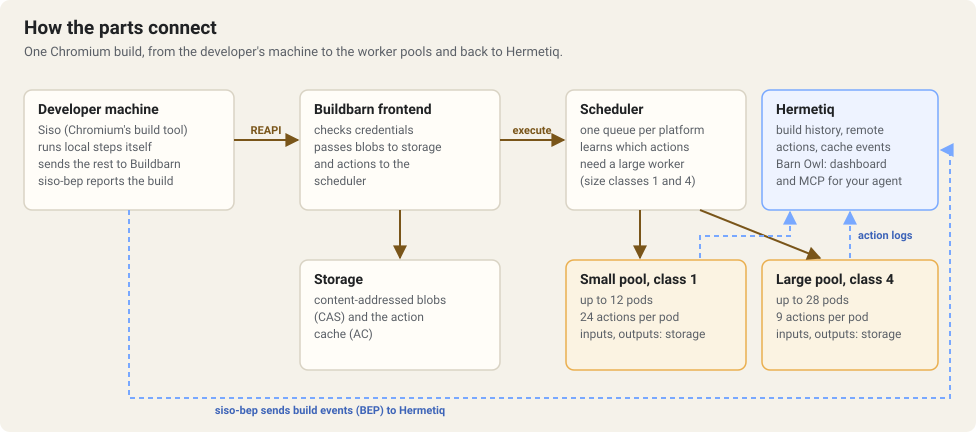
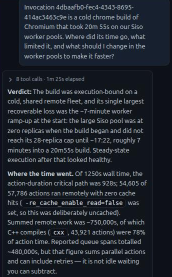
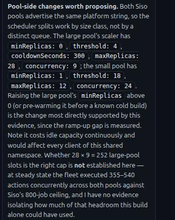

# Chromium on Buildbarn with Hermetiq

- repository: https://chromium.googlesource.com/chromium/src
- latest tested revision: bbc7a3c29870e0a8b3a3ac31ae909a38ab3d6328 (159.0.8128.0)
- build tool: Siso v1.6.7

Chromium's `chrome` target is about 57,800 build steps, most of them C++ compiles, with link outputs of up to 715 MB. This example builds it remotely on a Buildbarn installed from this repository, reports every build to Hermetiq, and uses Barn Owl to find what limits the build and what to change.

| | Before | After Barn Owl's recommendation |
| --- | --- | --- |
| Cold `chrome` build (median of 3) | 21m 18s | 16m 17s (24% faster) |

Both columns use the same 40 nodes, the same pools and the same client settings. The only change is the one Barn Owl recommended in [section 6](#6-make-it-faster-with-barn-owl): keeping the pools warm.

## Contents

1. [How the parts fit](#1-how-the-parts-fit)
2. [Set up the client](#2-set-up-the-client)
3. [Set up the cluster](#3-set-up-the-cluster)
4. [Build Chromium](#4-build-chromium)
5. [See the build in Hermetiq](#5-see-the-build-in-hermetiq)
6. [Make it faster with Barn Owl](#6-make-it-faster-with-barn-owl)

Field-by-field pool details, autoscaling and troubleshooting are in [reference.md](reference.md).

## 1. How the parts fit



| Part | What it does |
| --- | --- |
| Siso | Chromium's build tool. Decides which steps run remotely and sends them to Buildbarn. |
| [`siso-bep`](../../tools/siso-bep/) | Runs Siso and reports the build to Hermetiq as Build Event Protocol events, the way Bazel does on its own. |
| Buildbarn frontend | Checks credentials and passes blobs to storage and actions to the scheduler. |
| Buildbarn scheduler | Queues actions by platform and learns which ones need the large pool. |
| Two worker pools | Size class 1 (24 actions per pod) and size class 4 (9 actions per pod), one pod per 16-vCPU node. |
| Hermetiq | Build history, targets, remote actions, the timeline and critical path for every build, and Barn Owl. |

## 2. Set up the client

You need a Linux workstation with [depot_tools](https://chromium.googlesource.com/chromium/tools/depot_tools.git) and a Chromium checkout. Follow Chromium's [Linux build instructions](https://chromium.googlesource.com/chromium/src/+/HEAD/docs/linux/build_instructions.md) up to `fetch`, then point Siso at your Buildbarn with Chromium's [non-Google RBE settings](https://chromium.googlesource.com/chromium/src/+/HEAD/docs/linux/build_instructions.md#non-google-rbe):

1. Add the custom vars in [`client/gclient-custom-vars.txt`](client/gclient-custom-vars.txt) to your `.gclient`, pointing `reapi_backend_config_path` at [`client/backend.star`](client/backend.star). The backend config gives every remote action Chromium's public `siso-chromium` runner image as its platform.
2. Run `gclient runhooks`.
3. Create the output directory: copy [`client/args.gn`](client/args.gn) to `out/rbe/args.gn`, then run `gn gen out/rbe`.
4. Point Siso at your Hermetiq credential helper and check that it can authenticate:

   ```bash
   export SISO_CREDENTIAL_HELPER=$CREDENTIAL_HELPER
   third_party/siso/cipd/siso auth-check -reapi_address=bb.<your-domain>:443 -reapi_instance=$INSTANCE_NAME
   ```

5. Install `siso-bep`:

   ```bash
   go install github.com/Hermetiq/hermetiq-k8s/tools/siso-bep@v0.1.0
   ```

`<your-domain>` is your installation's `hosts.domainBase`, `$INSTANCE_NAME` is your Hermetiq project ID, and `$CREDENTIAL_HELPER` is the path to your Hermetiq credential helper, as in the [other examples](../envoy.md).

## 3. Set up the cluster

1. **Buildbarn values.** Merge [`buildbarn-values.yaml`](buildbarn-values.yaml) into your Buildbarn values and upgrade the release:
   - size-class analysis, which needs the ISCC store (see [ISCC size classes](../../docs/iscc-size-classes.md))
   - the File System Access Cache, which the pools' input prefetching needs
   - the predeclared queue for the Chromium platform

   Chromium's `chrome` binary is 715 MB, and Buildbarn can't store a blob bigger than one block of a store. Check your blocks are bigger than that; see [reference.md](reference.md#blob-size-limits).
2. **Nodes.** The pools expect 16-vCPU nodes with local SSD, one worker pod per node: a 13-CPU runner and a 2-CPU worker. The workers keep their cache and build files in `emptyDir` volumes, so the local SSD must back the node's ephemeral storage (on GKE, `--ephemeral-storage-local-ssd`). Set the node pool's maximum, and your cloud's quota (including local SSD quota), to at least the pools' combined maximum of 40.
3. **Pools.** Add [`rbeworkers/`](rbeworkers/) as a component to the overlay you apply your RbeWorkers with, then apply it:

   ```bash
   kubectl get rbeworkers,scaledobjects -n <buildbarn-namespace> | grep chromium
   ```

   Both pools should be listed. Small keeps one pod running; large starts at zero and scales on demand.

## 4. Build Chromium

The everyday command is [`client/build.sh`](client/build.sh). It sends every step to Buildbarn, including links, reads from the remote cache, and downloads only the outputs you need locally:

```bash
siso-bep --bes_backend=grpcs://bep.<your-domain> --project=$INSTANCE_NAME \
  --results_url=https://dashboard.<your-domain>/build/ -- \
  autoninja -C out/rbe \
    -reapi_address=bb.<your-domain>:443 -reapi_instance=$INSTANCE_NAME \
    --strict_remote --remote_jobs=800 \
    --config=no-remote-timeout,default-remote,googlechrome,remote-link \
    -output_local_strategy=greedy \
    chrome
```

| Setting | Why |
| --- | --- |
| `googlechrome` | Sends generator steps remote: mojo, Rust, nasm, TypeScript, grit and others. Without it they run on your workstation and become the bottleneck. |
| `default-remote` | Sends the remaining rules remote, including links. |
| `remote-link` | Links on a worker. `default-remote` already does this; it's listed to make the intent explicit. |
| `no-remote-timeout` | Removes Chromium's 2-minute remote timeout, which can expire while actions wait for a pool to scale up. |
| `--strict_remote` | Never runs a remote step on your workstation, even as a fallback. |
| `--remote_jobs=800` | Keeps actions queued behind every slot. Set it above your total slots, which is 540 for these pools. |
| `-output_local_strategy=greedy` | Downloads final outputs, such as the `chrome` binary, but not intermediate object files. |

The cold builds measured in this example add `-re_cache_enable_read=false` and use a new output directory, so every step runs.

## 5. See the build in Hermetiq

Every build shows up in Build History with its targets, remote actions, timeline and critical path, the same as a Bazel build. Four things make that work:

1. **The build exists before Siso starts.** `siso-bep` creates the invocation in Hermetiq first, so nothing that arrives during the build is dropped.
2. **One ID ties it together.** `siso-bep` passes its invocation ID to Siso as `--build_id`, and Siso sends it to Buildbarn on every remote action as the REAPI `tool_invocation_id`.
3. **The build's own record.** When Siso finishes, `siso-bep` reads Siso's per-step metrics and sends:
   - one target per GN target
   - the remote, local and cache-hit counts
   - the critical path
   - a trace profile, uploaded to Buildbarn's CAS, which gives Hermetiq the per-action timeline
4. **The workers' record.** Each worker reports every action it runs to Hermetiq's completed-action logger: which pod ran it, and how long it queued and executed. Hermetiq files it under the same invocation by `tool_invocation_id`.

Where to look:

- **What ran remotely?** Build History and the invocation overview: executions, remote executions and cache hits.
- **Where did the time go?** The invocation timeline and critical path, from the uploaded profile.
- **Which workers ran it?** Actions Executed: remote execution time per action type, input fetch and output upload, and parallelism over time.

## 6. Make it faster with Barn Owl

Start from the "before" build: the large pool runs 9 actions per pod and starts from zero. It took 20m 55s. Open the build in Build History, click **Ask Barn Owl**, and ask a plain question:

> Invocation `<id>` is a cold chrome build of Chromium that took 20m 55s on our Siso worker pools. Where did its time go, what limited it, and what should I change in the worker pools to make it faster?

Barn Owl reads the build, the scheduler's queues and the pools' scaling history, and links each claim to its evidence. On this build it found:

- **Where the time went.** 54,605 of 57,786 actions ran remotely; C++ compiles were 78% of action time.
- **What limited it.** Only the first 7 minutes, while the large pool scaled from zero to its 28 pods. Until then 0–177 actions were running while 775–800 waited, with a p95 queue wait of 163s. After that 355–540 ran at once and p95 queue wait fell to 15–40s.
- **What didn't.** Input fetch p95 stayed under 0.15s and output upload p95 under 2.1s. A higher `maxReplicas` wasn't justified, because the queue drained once the pool was full.
- **Recommendation.** Raise the large pool's `minReplicas` above 0, or warm it before a known cold build, and compare the ramp-up interval.





Warming the pools is a change to `minReplicas` in [`rbeworkers/worker-chromium-large.yaml`](rbeworkers/worker-chromium-large.yaml), or a KEDA cron window (see [reference.md](reference.md#the-pools)). With both pools warm, the same build took 16m 17s, the median of three runs: 24% faster. Warm pools cost node time between builds, so keep them warm only when builds are expected.

What's left is mostly the build's own shape. Hermetiq's critical path for the warm builds is about 12 minutes (11m 35s to 12m 43s), and it ends with the `chrome` link: about a minute of linking on a worker, then 2–4 minutes downloading the 715 MB binary to the workstation. More actions per pod didn't help: at 12 actions per large pod, large-pool pods used 10.4–11.6 of their 15 CPUs and small-pool pods 13.4–13.6, and the build took no less time than at 9.

You can also ask the same questions from your own coding agent: connect it to Hermetiq's MCP server, and it can read the same build, cache and worker data next to your manifests and Siso flags.

## How these numbers were measured

Measured on 10 November 2026 with one Chromium commit, one 8-core Linux workstation as the client, and 40 spot 16-vCPU nodes with local SSD (28 large, 12 small). Every run was a cold build of `chrome`.

| Runs | Pools | Times | Node-minutes |
| --- | --- | --- | --- |
| Before | large starting from zero after its nodes were removed | 20m 55s, 21m 18s, 23m 12s | 628, 655, 685 |
| After | both warm | 15m 17s, 16m 17s, 16m 28s | 569, 634, 638 |
| Large at 12 actions per pod | both warm | 15m 37s, 17m 21s | 610, 674 |

The first two rows use the pools in [`rbeworkers/`](rbeworkers/), with the large pool at 9 actions per pod. Node-minutes add up the Siso worker pods running during the build, sampled every 30 seconds; they don't include the time warm pools spend idle between builds.
